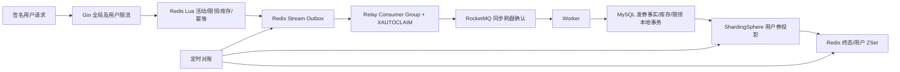

# 设计与故障处理

## 数据与链路

`control.templates/grants/user_limits/batches/batch_items` 是控制面数据。模板行锁、库存扣减、限领计数和发券事实同事务提交。`grants.id` 是 `SHA256(merchant/user/template/request)`，数据库主键兜底重复消息；`user_limits` 复合主键保障用户限领记录唯一。成功事实包含券快照，作为投影重试依据。

用户券通过 Proxy 按 `user_id % 2` 路由数据库，`floor(user_id/2) % 2` 路由物理表，共两库四表；商户模板查询投影以 `merchant_id` 使用同样规则。商户模板的库存裁决仍在控制库进行。普通用户查询、更新均携带用户分片键；全局过期扫描和对账会广播到分片。

这是本地事务加可重放投影的最终一致性模型。控制库事务提交后再写用户分片，避免将两种路由键放入未经保障的跨库 LOCAL 事务；控制库与投影间短暂延迟是可观测的。投影写入失败只重试，不退库存，否则可能把已经提交的发券事实当失败再次发券。控制面是单库，热点模板的行锁仍限制最终 TPS；用户分片解决券数据容量与按用户查询，不能消除控制面的串行库存更新成本。

## 状态与幂等

| 阶段/故障窗口 | 行为 |
|---|---|
| Lua 校验失败 | 不扣库存、不更新限领、不写 Outbox |
| Lua 执行成功后 API 崩溃 | 预留账本和 Stream 已存在，重试同一 request_id 返回同一事件 |
| Stream 取出后 Relay 崩溃 | 消费组保留 pending，10 秒后 XAUTOCLAIM 接管 |
| MQ 已收到但 Relay 未 ACK | 重复投递，数据库事实主键消重 |
| MQ 发送失败或未返回 SendOK | 不 ACK Stream，等待重试 |
| SQL 提交后 Worker 崩溃 | 重读同一成功事实，幂等写入用户券 |
| 用户券已写但 Worker 未确认 | 不覆盖券使用状态；重放读取真实用户券后更新缓存 |
| 数据库业务拒绝 | 保存 failed 事实，Lua 一次性回补库存和限领计数 |
| 数据库/Proxy/Redis 暂时不可用 | MQ retry later；不贸然补库存；对账可重新入 Stream |
| 异常消息 | 无法解析的消息持久写入 Redis deadletters 后才确认；MQ 自身也有重试和 DLQ |
| 对账发现库存/限领漂移 | 扫描预留事实，读取版本；Lua CAS 确保没有新抢券/终态变化才重建计数 |
| Redis 元数据或库存键丢失 | 拒绝新受理，拒绝盲目预热；从持久备份恢复后再开放 |

Worker 校验消息内容与 Lua 保存的预留事实一致。只有数据库的终态能触发 `pending → issued/failed`，终态重复执行不改变库存。永久失败按业务规则处理，基础设施超时没有自动撤销期限。过期前受理的消息可以在活动结束后落库，券是否可用仍按券有效期判断。

库存关系：`初始库存 = 数据库剩余 + issued grants`；静止状态下 `issued grants = 用户券投影数量`、`Redis剩余 = 数据库剩余`。流水处理中另核对 `Redis剩余 + 预留总数 - failed预留数 = 初始库存`。对账扫描期间可能仍有状态变化，`audit` 是诊断快照，压测在排空后断言全部一致。每 15 秒尝试对账和过期流转，维护锁防止多实例同时扫描；失败会记结构化日志，下轮重试。

## 核销与缓存

核销条件更新同时检查用户、商户、状态、有效期和门槛，成功才写订单号；`UNIQUE(user_id,order_id)` 阻止同一用户订单使用两张券。相同券和订单重试成功，其他订单不能再次核销。结算是报价，最终以条件更新为准；订单系统需要保证订单归属和金额真实。

模板查询先检查缓存、Redis 位图 Bloom，再使用带随机令牌的互斥锁重建；解锁 Lua 校验令牌。四次哈希映射到 2^24 位，允许假阳性。创建前先加 Bloom 位，启动补全位图后设置 ready；过滤器未就绪时回源数据库，避免冷启动误判。不存在模板短缓存 5 秒，热点模板缓存 60 秒。

用户券按到期时间写 ZSet，用 Pipeline 批量读券快照，固定最多 8 个 Go goroutine 计算并排序。冷缓存或条目丢失回源数据库；券状态会在发放和核销时更新，定期过期流转。缓存报价可能与正在发生的核销并发，数据库核销始终再次验证。

批量导入用 Excelize Rows 流式读首表，Redis Set 与批量 Stream 入队在 Lua 中去重和原子执行；后台消费者用稳定的 `batch:<batch-id>` 请求号走同一抢券链路。`batch_items` 主键 `(batch_id,user_id)` 使进度写入幂等，消费崩溃后不会重复增加统计。导入连接中断时已经排队的行仍执行，批次可能处于 importing/partial，需要按已知批次 ID 检查结果。未解析的文件尾部不属于已受理数据。

## 运维边界

- Compose 使用 Redis AOF `appendfsync always`、`noeviction` 和 RocketMQ `SYNC_FLUSH`。这些配置保护进程重启窗口，不能保证整个单机磁盘损坏后不丢数据；部署是单节点演示，不提供跨机房容灾。
- `scripts/recovery.ps1` 真的停止 Broker，在故障期间受理，观察 PEL，停止应用并重启 Redis，然后恢复 Broker 和应用并核对发券。只作用于 flashcoupon Compose 项目。
- Redis 完整丢失不能凭数据库剩余库存直接重建：数据库尚未看到的已受理事件也占库存。恢复 AOF/备份与消息日志后核对；若持久数据也丢失，需要业务审计决定如何处理，程序保持关闭受理。
- 首次预热先持久标记初始化，再暴露 Redis 库存；两个步骤之间崩溃时保持关闭受理，避免把可能已有受理的活动误当全新库存。新模板若在此窗口初始化失败，需要运营确认无受理流水后恢复，不能自动清除标记。
- 用户券库应使用备份恢复。对账补写针对尚未完成的投影；不能把主动删除已核销券当成普通投影缺失来处理，因为核销状态必须从持久备份保留。
- Stream、预留账本、批次 Set 和发券事实保留用于审计，不使用 MAXLEN 任意裁剪。生产归档需在活动结束、消息排空、账目一致并满足业务幂等保留期之后执行。
- 健康接口检查数据库与 Redis。MQ 故障时抢券可以继续受理，运维应监控 `/admin/audit` pending、Stream PEL/lag、RocketMQ 消费延迟/DLQ、数据库剩余与投影差异以及维护错误日志。

参考实现接口：[RocketMQ Go 官方消费者](https://github.com/apache/rocketmq-client-go/blob/v2.1.2/examples/consumer/simple/main.go)、[官方生产者](https://github.com/apache/rocketmq-client-go/blob/v2.1.2/examples/producer/simple/main.go)、[ShardingSphere 5.5.2 分片规则](https://shardingsphere.apache.org/document/5.5.2/cn/user-manual/shardingsphere-jdbc/yaml-config/rules/sharding/)。
