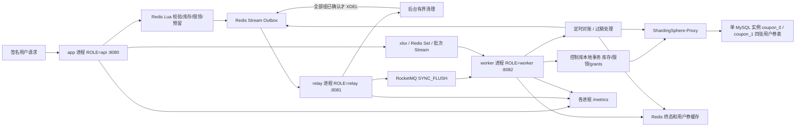

# 架构、指标与可靠性

## 真实部署



三个进程共享镜像，ROLE 决定启动的任务和路由。只有 API 注册业务 HTTP；Relay/Worker 的 HTTP 仅用于健康检查和指标。API 启动不依赖 MQ；后台服务等待 Nameserver、Broker、Topic。分片配置等待 Proxy 和 MySQL，所有宿主端口只绑定 loopback。`ROLE=all` 保留给单进程集成测试，不是当前 Compose 部署形态。

MySQL 健康检查明确使用 TCP，不能把初始化阶段的临时 Unix socket 当成正式服务。Topic 初始化直接指定 Broker，并检查 NameServer 中确实存在 broker-a 的 Topic 路由；不能仅凭 mqadmin 的退出码判定成功，因为空集群时它可能打印错误却返回 0。初始化采用有限重试，独立全新数据卷启动已实际验证。

收到 SIGTERM 后 HTTP 停止接入，最多等待 15 秒排空；超时显式关闭连接。后台任务使用可取消 context、WaitGroup 和幂等 Close；关闭 MQ Consumer、等待 Stream/批次/维护/采样协程退出后关闭 Producer 和数据库连接。MQ 回调有 30 秒处理超时。Compose 给 60 秒退出宽限。崩溃或取消造成的不确定提交靠重投和 SQL 主键处理，不提前 ACK。

## 数据与库存语义

`control.templates/grants/user_limits/batches/batch_items` 在同一个 MySQL 实例的控制库。模板行锁、库存扣减、用户限领和 grants 成功事实在一个本地事务中提交。`grants.id=SHA256(merchant/user/template/request)`，唯一主键防止重复发券；用户限领复合主键和模板行锁防止同用户不同请求超限。

用户券经 Proxy 按 `user_id % 2` 路由逻辑库，`floor(user_id/2) % 2` 路由表，合计两逻辑库四张表；商户模板查询投影按 merchant_id 使用相同规则。当前不是多个 MySQL 实例，也没有验证物理扩容收益。用户查询/核销携带用户分片键；全局过期、计数与对账广播。

控制库先保存成功事实和券快照，再幂等写用户券投影，再更新 Redis 终态/缓存。跨控制库和用户分片使用可重放投影的最终一致性，不宣称跨库 LOCAL 原子事务。投影暂时失败只重试，不退已提交库存。控制库行锁仍是热点模板最终 TPS 的限制。

静止状态验证：`初始库存 = SQL剩余 + issued事实`，`issued事实 = 用户券投影数`，`Redis剩余 = SQL剩余`。流水中验证 `Redis剩余 + 预留总数 - failed预留数 = 初始库存`。审计不是跨 Redis/MySQL 的一致快照，流转中可能短暂不一致；验收必须等 pending=0 再确认全部等式。

## 故障窗口

| 窗口 | 保障 |
|---|---|
| Lua 后 API 崩溃 | 校验、扣库存、限领、预留和 Stream 同脚本；同请求返回原事件 |
| Relay 取出后崩溃 | PEL 保留；空闲 10 秒后 XAUTOCLAIM 接管 |
| MQ 已接收但 Relay 未 ACK | 允许重投；只在 SendOK 后 ACK，SQL 唯一事实消重 |
| SQL 提交后 Worker 崩溃 | 重读券快照，幂等补齐投影，不重复扣库存 |
| 投影已写后回调失败 | MQ retry later；重复投影不覆盖已核销状态 |
| SQL 永久业务拒绝 | 保存 failed；Lua `pending→failed` 只补偿一次 |
| DB/Proxy/Redis/MQ 短时故障 | 消费重试、不提前确认、不按超时回补库存；对账可重新写 Stream |
| 异常消息 | 保存 deadletters 后才确认；MQ 自身也有 retry/DLQ |
| 库存/限领计数漂移 | 预留快照配合 revision CAS，避免覆盖并发抢券或终态变化 |
| Redis 键或完整账本丢失 | 关闭受理，不依据 SQL 剩余数盲目初始化；先恢复持久数据再核对 |

首次初始化先持久标记再暴露 Redis 库存，中间崩溃保持关闭受理。Redis AOF always、noeviction 和 Broker 同步刷盘覆盖已测试的进程重启窗口；不能抵御单机磁盘损毁。发券在活动期内受理，消息可在活动结束后落库，券仍按自身有效期限制使用。

每 15 秒由 Worker 尝试对账和过期流转；维护租约避免同时间重复扫描。SQL 成功但缺失的投影可以补齐。不能主动删除已核销券再将其当普通缺失投影重建，核销状态应由备份恢复。预留账本保留用于幂等、补偿和恢复；已确认的 Outbox 载荷由独立后台安全清理，规则见下节。库存账本和批次 Stream 的归档不在本次清理范围。

核销使用状态、商户、用户、门槛、有效期条件更新；`UNIQUE(user_id,order_id)` 防止同用户订单用两张券。相同券和订单重复请求成功，其他订单拒绝。结算是报价，最终核销再次校验；订单系统负责真实归属/金额。过期券不会参与报价或成功核销。

模板缓存包含 Bloom 位图、空值短缓存、带令牌互斥重建；用户券使用 ZSet/Pipeline 和最多 8 个计算 goroutine。缓存报价可与核销并发而暂时过时，SQL 是核销裁决。Excelize Rows 流式导入，Redis Set+Stream Lua 原子去重，后台批次使用稳定请求 ID 进入同一发券链路，batch_items 主键保障进度幂等。

## Outbox 生命周期与安全清理

`XADD → unread → XREADGROUP/PEL → MQ SendOK → XACK → 可清理 → XDEL`。ACK 代表 MQ 已接管消息，不代表 SQL 已发券。Redis 的 `reservations/states/users/revision` 与 SQL `grants` 是独立恢复依据，清理只触及 `fc:outbox` 的消息载荷；对账仍可用完整预留重新 XADD，不依赖旧 Stream ID。SendOK 之后、ACK 之前崩溃会重复投递，不能清理此时仍在 PEL 的消息。

[cleanup.lua](../internal/app/lua/cleanup.lua) 将组游标/PEL 检查和 XDEL 放在同一 Redis 原子脚本中：每轮最多扫描 128 条，用字符串比较完整 Stream ID，只有所有当前消费组的 last-delivered-id 均不小于该 ID、且各组 PEL 都不含它才删除。没有 `relay` 组、无消费组或超过 8 组时停止删除。逐条判定允许删除已 ACK 的后续消息，不因一个旧 Pending 阻塞整段清理。它不使用 MAXLEN、按消息年龄删除或仅按“最小已读游标”推断 ACK。

[outbox.go](../internal/app/outbox.go) 在 Relay 后台每 100 ms 执行一轮，带 2 秒调用期限；多个 Relay 可同时清理、读组和接管。检查与删除原子化避免清理竞态，重启只会从头继续扫描，不存在不可恢复的内存游标。API 抢券不增加清理操作；Redis 仍共享单主执行资源，有界脚本也有 CPU 成本，不能称为物理资源完全隔离。消费者组由应用管理，运维不能随意 XACK、删除组、重置组游标后要求历史重放；新建组也不能恢复已清理载荷，应从预留/事实进行业务恢复。

清理有吞吐上限，其他消费组落后或 Broker 故障时消息保留，不能保证 Redis 恒定内存。即使 XLEN=0，Stream 键、消费组/消费者元数据仍占内存；XDEL 也不承诺立即等比例释放 allocator RSS。预留账本、批次 Stream、死信及 MQ 数据保留仍需要独立归档策略。对账会补投超过 15 秒的 pending，30 秒重试标记只减少频率；SQL 长期变慢时可能重复发送已在 MQ 中的任务，属于可测量的额外成本，未引入新的交接终态或更改库存语义。

## 仅用于对照的 Stream Worker

显式给 `ROLE=worker` 设置 `TEST_STREAM_WORKER=1`，可跳过 MQ 消费、启动 20 个有界 Stream 消费协程；使用相同 `relay` 消费组、10 秒 Pending 接管和清理规则，但只有 `Deliver(...,"async")` 完成（包括投影、缓存、终态或失败补偿）才 ACK。它复用原 `Claim`、Lua、SQL 事务与幂等，不是 `/claims/direct` 同步基线。默认 Compose 不设置此开关，主架构仍为 Relay + RocketMQ。

实验模式与 Relay 必须互斥。实验脚本先排空、停两种消费者，再切换模式，不支持线上混跑或存在未完成任务时迁移；通过临时 Compose 覆盖文件设置开关，最后恢复默认服务。`TEST_DISABLE_OUTBOX_CLEANUP=1` 仅用于控制清理前后测量，默认关闭。实验配置、三轮原始数据与局限见 [双队列实验报告](QUEUE_EXPERIMENT.md)；不能因增加 RocketMQ 就预设更快。

## 指标口径

指标使用独立 registry，固定 role 标签。不使用用户、商户、请求、模板或原始 URL 作为标签；未知路由和非标准方法归一化。指标抓取不现场扫描账本，后台采样失败保留旧值，并通过时间戳暴露陈旧程度。

| 指标 | 意义 |
|---|---|
| `flashcoupon_http_requests_total` | 请求计数：route/method/status；rate 得到 QPS |
| `flashcoupon_http_duration_seconds` | 延迟 Histogram；聚合 bucket 可求 P95/P99 |
| `flashcoupon_claim_responses_total` | mode/outcome=accepted,rejected,limited,error；包含请求幂等重放 |
| `flashcoupon_delivery_attempts_total` | 消费/同步发券尝试，包含重复投递；不是唯一发券量 |
| `flashcoupon_grants{role="worker",state="issued/failed"}` | 从 MySQL 采样的唯一终态事实 Gauge，重启和重投不重复累计 |
| `flashcoupon_projected_coupons{role="worker"}` | 用户分片实际券数 Gauge；SQL fact 成功可能短暂先于投影 |
| `flashcoupon_message_backlog` | outbox/batch 的 unread、PEL pending；pipeline pending 来自最近一次对账，覆盖 MQ/落库未完成部分 |
| `flashcoupon_outbox_entries` / `flashcoupon_outbox_memory_bytes` | Outbox 物理条数与 MEMORY USAGE（含组/PEL 元数据，不含库存预留账本） |
| `flashcoupon_relay_forward_total` | confirmed/error/unconfirmed 发送尝试，包含重复，不是唯一发券数 |
| `flashcoupon_outbox_cleanup_total` / `flashcoupon_outbox_cleanup_seconds` | scanned/deleted/blocked/error 及每轮耗时；blocked 表示缺少必需组或组数超限 |
| `flashcoupon_message_retries_total` | relay/worker/batch/ack 失败重试计数 |
| `flashcoupon_delivery_stage_seconds` | SQL 事务、Relay SendSync、投影、缓存阶段耗时，包含等待 |
| `flashcoupon_background_errors_total` | 对账、锁、指标采样等错误计数 |
| `flashcoupon_reconcile_mismatches` | 最近对账快照不匹配数，流转中可瞬态出现 |
| `flashcoupon_*last_success_timestamp_seconds` | 对账/采样最后成功时间，读取 Gauge 时同时监控新鲜度 |

```promql
sum by (route) (rate(flashcoupon_http_requests_total{role="api"}[1m]))
histogram_quantile(0.95, sum by (le,route) (rate(flashcoupon_http_duration_seconds_bucket{role="api"}[5m])))
histogram_quantile(0.99, sum by (le,route) (rate(flashcoupon_http_duration_seconds_bucket{role="api"}[5m])))
time() - flashcoupon_metrics_last_success_timestamp_seconds{role="worker"}
```

唯一发券指标是持久事实/投影的 Gauge，不用 `rate()` 解释成严格的事件 TPS；压测从唯一最终发券数和明确的开始/排空窗口计算 TPS。多个 Worker 会重复采样同一份全局事实，应使用 `max` 而非求和。进程 CPU/内存由 Go process collector 暴露，压测还采样 Docker 服务和 k6 容器资源。

参考：[Prometheus Histogram](https://prometheus.io/docs/practices/histograms/)、[Go promhttp](https://pkg.go.dev/github.com/prometheus/client_golang/prometheus/promhttp)。RocketMQ SDK 并发补丁及可复现实验见 [来源说明](../third_party/ROCKETMQ_PATCH.md)。
