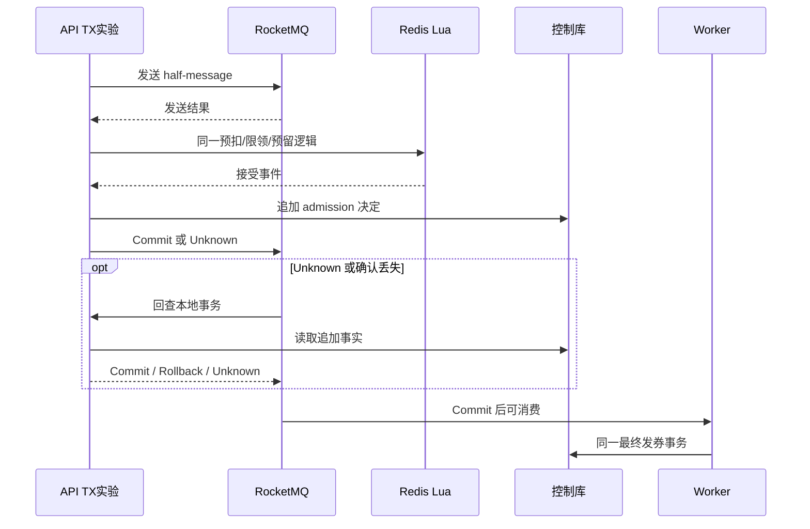

# Stream Outbox 与 RocketMQ 事务消息对照

默认路径继续使用 Stream Outbox。本轮另建 `transaction` 模式、独立 `FlashCouponTransactionGrant` Topic 与 `fc-transaction-experiment` Producer Group，用真实 TransactionProducer 验证 half-message、Commit、Rollback、Unknown 和 Broker 回查。它是可关闭的实验，不替代默认路径，也不与普通 Outbox 同时发送同一个请求。

## 各自把可靠交接放在哪里

| 维度 | 默认 async / Stream Outbox | transaction 实验 |
|---|---|---|
| HTTP 同步工作 | Redis Lua 原子预扣、预留和写入 Stream | 先发送 Broker half-message；本地回调执行同一 Lua 预留，再追加 SQL admission 事实，返回事务决定 |
| 受理证据 | 模板 reservations/states 与 Stream 事件同脚本登记 | 同样的模板账本及全局事务预留索引；另有 `control.transaction_events` 追加事实 |
| 消息发布 | Relay SendOK 后 Stream ACK | 本地 Commit 使 half-message 对消费者可见；Unknown 由 Broker 回查 |
| 重启恢复 | Stream 未读/PEL、MQ 重投和 Worker 对账 | 回查读 SQL 决策；缺失 SQL 时从 Redis 预留修复；API 后台扫描未终结预留，向 TX Topic 补投 |
| 最终业务 | Worker 调同一 `Deliver`、`Store.Grant`，行锁、库存、限领、grants、投影与补偿规则相同 | 同左；模式隔离防止跨路径错误处理 |
| 入口故障依赖 | Broker 不可用仍可 Redis 受理 | Broker 与 admission SQL 都进入同步路径，依赖和延迟增加 |
| 额外状态成本 | Stream + 预留账本 + MQ；清理只释放已安全交接的载荷 | half-message / Broker 回查 + SQL admission 表 + Redis 全局恢复索引；没有因此消除预留账本 |



## 为什么这不是 Redis + SQL 原子事务

Redis 预留成功与 SQL admission 提交是两次独立调用。`transaction_events` 保存的是“允许发布领取事件”的事实，**不是 grants 最终成功发券事实**；它的主键是同一个稳定事件 ID，decision/event/trace 写入后不更新。SQL 追加失败不能当作 Redis 已回滚；Broker 得到 Unknown，回查或后台恢复从保留的 Redis 事件补写事实。只有最终 SQL 发券事务确认永久拒绝，才按原规则归还预留。

`transaction.go` 的恢复扫描每 15 秒执行、单轮最多 12 秒及 16 页，HSCAN count=64 是每页扫描提示，不是严格条数上限；30 秒 NX 标记降低重复补投，不能替代 SQL 幂等。早期每轮仅一页会让恢复随历史账本页数显著变慢，已调整为有界多页，早期样本仍保留。Broker 的回查间隔与预算在实验专用配置中为 5 秒/15 次，预算耗尽后仍依赖 Redis 预留与在线 Producer 的扫描。API 全部离线时没有这项扫描；持久存储丢失也不在恢复保证内。

SDK 的 SendMessageInTransaction 使用一次 half-message 同步发送、本地事务回调及事务结束通知，通知失败仍可能由后续回查收敛。HTTP 结果不确定时，客户端必须用同 request ID 重试。测试开关 `TX_TEST_UNKNOWN/TX_TEST_ROLLBACK` 仅为隔离实验环境使用，基础 Compose 默认不注册该模式。

## 已验证和不能推出的结论

- [真实 Broker race 集成测试](../evidence/observability-2026-11-19/transaction/broker-integration.json)：Commit 最终一张；Rollback 不预扣不发券；Unknown 观察到实际回查后最终一张；同 ID 重放及投影重放不增加事实。
- 同套件的 20 并发 / 100 张事务发券也通过 race 与最终审计；测试是可恢复性验证，耗时记录保留，不把最终正确等同于低延迟。
- [Producer 崩溃测试](../evidence/observability-2026-11-19/transaction/crash-summary.json)：在 Redis 已受理、SQL admission 已提交两处 kill API，无 HTTP 重试也收敛；另有无 half-message 的孤立预留恢复回归。这不等于遍历所有 Broker 回查耗尽时序。
- 性能见[逐轮结果](../evidence/observability-2026-11-19/results.md)和[跨机说明](DISTRIBUTED_EXPERIMENT.md)。小规模实验测量的是整个协议成本，不是仅比较 MQ 某个调用。不得预设事务消息提高最终 TPS，也不能把 Commit admission 当作已完成发券。
- 更早的 [Stream→Worker 对照](QUEUE_EXPERIMENT.md)仍有效：Redis 单层也能通过幂等/恢复完成发券；双队列正常负载未证明吞吐优势，载荷搬出 Redis 的收益也不能等价为 Redis 总内存下降。本轮没有重写那套历史实验。

同机 500 请求/30 VU、Trace-on、Worker=20 三轮中位数：默认 Outbox 的 HTTP 受理 **1742.16 QPS**、最终 **213.13 TPS**；事务方案 **1057.08 QPS**、**7.43 TPS**，P95 分别 41.00/32.49ms，后台排空分别 2.07/66.79 秒。P95 接近不能掩盖最终完成长尾。事务路径观察到 Broker 回查与后台补投，当前组合的最终完成代价显著更高；尚未将长尾唯一归因于某个 Broker/SDK 内部缺陷，也没有据此修改 SDK 协议实现。

这组结果没有支持替换主链路。需要特别限定：实验保留同一持久 Broker/Redis 栈，回查和补投可能包含历史 half-message；各轮只以业务事实/投影/库存收敛为结束，没有证明 Broker 系统 half-message 队列全部清空。因此 7.43 TPS 是该环境下的真实最终完成吞吐，不能把全部差值归因于事务协议本身。系统最终一致也不意味着延迟可接受；若要投入实际使用，还需要隔离历史消息、定位事务提交/回查长尾并做持续负载验证。失败和早期探索样本见 `experiments/exploratory`，未混入上述三轮中位数。

## 复现

```sh
docker compose -f compose.yaml -f compose.sharding.yaml -f compose.observability.yaml -f compose.transaction.yaml up -d --build
docker compose -f compose.yaml -f compose.sharding.yaml -f compose.transaction.yaml run --rm --no-deps tx-topic
python scripts/verify_observability.py
python scripts/transaction_faults.py
python scripts/distributed_experiment.py --k6 reports/tools/k6.exe --only transaction --run-tag mytrial
```

常规接口仍为 `/v1/claims`，实验接口为 `/v1/claims/transaction`，需 transaction 模板；默认部署不启用该接口。现有数据卷的可选表由 flag-enabled API 初始化创建，新卷也可执行 [002 SQL](../deploy/mysql/002-transaction-experiment.sql)。源码：[transaction.go](../internal/app/transaction.go)、[Lua](../internal/app/lua/claim.lua)、[真实测试](../internal/app/transaction_test.go)、[专用 Compose](../compose.transaction.yaml)。
