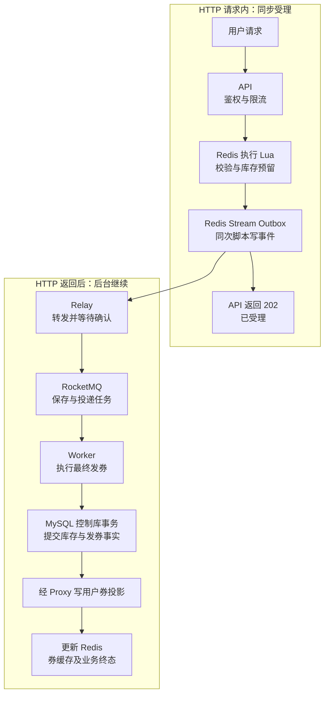

# FlashCoupon 面试核心

资料导航见 [README](README.md)，深挖见 [项目指南](PROJECT_GUIDE.md)。本次只整理已有实现和测试证据，不重新压测；初读A→D，复习B的状态和F的八题。

## A. 项目介绍

### 约 1 分钟版本

FlashCoupon 是一个面向多商户营销的高并发抢券与核销系统，支持限量抢券、批量发券和核销。系统主要解决两个问题：高并发条件下的库存竞争和数据库性能瓶颈，以及异步发券中的消息可靠性和数据一致性。

入口使用 Redis Lua 原子完成校验、库存预扣和事件登记，再由消息队列和 Worker 异步发券。MySQL 事务保证库存与发券事实一致，用户券另做幂等投影，未完成步骤通过重试和对账修复。

同负载三轮压测中，HTTP 受理 QPS 约从 266 提到 2137，P95 从 122 降到 32 毫秒；5000 个并发用户竞争 2500 张券，最终没有超发或重复发券。这里提升的是接口受理，最终发券 TPS 没有提高；当前验证仍是单机环境。

### 展开到 1～2 分钟时补充

受理不等于发券；事件和预留同写，避免预扣后丢任务。Relay 等消息队列确认接收后再确认 Stream，Worker 才负责数据库落库。数据库已经成功、用户券还没写出来时，重试会读原事实并补齐用户券，不重复扣库存；明确拒绝才回补Redis预留。

双队列对照支持清理已转发载荷，但未证明正常吞吐或Redis总峰值内存更好，且增加Broker故障依赖。当前是单MySQL内的逻辑分片，未验证物理扩容或生产高可用。

## B. 一次抢券：先受理，再完成发券

**Redis** 保存数据并执行命令；**Lua** 是在 Redis 内执行多步操作的脚本，不是独立队列。**Redis Stream Outbox** 是“用 Stream 实现的待发送事件箱”，Outbox 是设计用途，不是新数据结构。“同脚本登记事件”具体就是：领取 Lua 在预扣的同一次执行中，把事件写入 Redis Stream。

以小明抢一张券为例，按下面顺序讲：

1. **API 鉴权与限流**：先确认是谁领取，防止冒用其他用户；再限制请求频率，减少突发流量对共享资源的冲击。限流不等于判定有库存，用户仍要通过领取校验。
2. **Lua 完成库存预留**：判断活动、库存、用户限领及同请求是否已受理。首次成功会把 Redis 库存实际减一（库存预扣）、预占用户次数、保存请求事件和业务 pending，并写 Stream。库存预留指这一整套受理过程，不只是减库存。
3. **API 返回 202**：表示这次请求已被记录并接受后续处理，不是拿券成功。鉴权、限流、模板读取及 Lua 都在 HTTP 请求内；消息转发、SQL 发券和投影移到后台。后台读的是保存的事件，不需要原 HTTP 连接继续存在。
4. **Relay 与 MQ 交接**：Relay 从 Stream 取事件，等 RocketMQ 确认接收后才确认该 Stream 消费记录。RocketMQ 再把任务交给 Worker；Relay 不执行发券 SQL。
5. **Worker 提交控制库事务**：先核对事件确实来自原始预留，锁住模板行，检查同事件是否已有结果及 SQL 库存/用户限领；新成功事务把 SQL 库存减一、用户已发计数加一、grants 成功事实和券快照一起提交。
6. **投影、缓存与终态**：Worker 把快照幂等写成用户券表中的一张券（用户券投影），供查询和核销；随后回读实际券状态，更新 Redis 券详情及可用券索引，最后把预留的业务 pending 改为 issued。发券事实保存“这次发了什么”，用户券则继续记录以后是否过期、被哪个订单核销。

| 走到哪里 | 可以确认什么 | 还不能据此确认什么 |
|---|---|---|
| HTTP 202 | Redis 已完成受理与事件记录 | SQL 已发券 |
| control.grants=issued | 库存、用户计数、发券事实已提交 | 用户券投影和 Redis 更新都完成 |
| 用户券投影已写入 | 面向用户的数据已存在 | Redis 缓存/业务终态已刷新 |
| Redis 业务终态=issued | 该事件已完成上述成功处理步骤 | 消息只投递过一次，或永远不会再次重放 |

后续失败不能把已有 SQL 成功当成不存在，否则券已发出却退回库存，会再次放出名额。成功主线之外：临时错误重试，SQL 明确拒绝则记 failed 后补偿；重放投影不覆盖已有核销状态。具体失败位置见 C、D。

## C. 三个核心难点与取舍

### 1. 库存竞争和异步削峰

假设只剩一张券，小明和小红同时读到“库存=1”，若各自检查后直接发券，就可能发出两张。“读、判断、扣减”必须形成受保护的一步。Lua 执行期间不被其他请求穿插：先校验是否能领，再实际预扣，最后同次登记事件，分别解决“能不能受理”“名额被谁占用”“后台依据什么继续”。原子执行不等于错误自动回滚，代码还预检查键类型。

项目**按库存和用户限领限制受理，没有给 Stream 设置队列长度上限**。Redis 快速完成这部分后就能返回 HTTP；原本请求内等待的数据库事务、用户券写入和缓存刷新改到后台执行。这叫削峰：先接住突发、再按后台能力消化，不是提高 MySQL 本身处理能力。Redis 挡住入口竞争，MySQL 模板行锁和事务则对最终发券再作裁决；后者抵御重复消息和换请求ID多领，不能只信入口。

| 问题 | 方案为什么有效 | 付出的代价 |
|---|---|---|
| 同时读库存造成竞争 | Lua 原子预留；SQL 模板锁内检查并提交 | Redis、模板行都是共享热点 |
| HTTP 一直等落库 | 保存事件后先返回，后台继续事务与投影 | 用户要接受“受理后稍等”，最终 TPS 不一定增加 |

### 2. 可靠消息传递：按中断位置判断

若小明的 Redis 预扣成功，API 却在发 MQ 前宕机，只做“扣库存→直接发送”就会留下没有后续任务的预留。把完整事件与预留写在同一 Lua 中，便留下可恢复的任务依据：API 即使退出，Relay 仍能从 Stream 继续读。Relay 是本项目选择的桥接进程，不是 Redis 与外部系统交互的必需工具。

Relay 取到消息只说明开始交接，立刻 ACK（确认消费）会在转发失败时丢掉待处理标记。因此它等 MQ 发送确认；若 MQ 已接收但 ACK 前 Relay 宕机，重启又会发同一事件。重复无法仅靠确认顺序消除，需发券幂等兜住。MQ 接收以后，消费失败由 MQ 重投；Stream 的 Pending 接管和 MQ 消费重试是两段不同的恢复，见 D 的阶段表。

| 失败位置 | 谁继续处理 | 正确性依据 |
|---|---|---|
| API 受理后退出 | Relay 读取 Stream | 预留与事件同次写入 |
| Relay 发送失败/ACK 丢失 | Relay 接管 Stream PEL Pending 并重发 | 不提前 ACK；相同事件可重做 |
| MQ 已交接、Worker 处理中断 | MQ 消费重试，必要时对账补投 | SQL 事实、投影和终态处理幂等 |

**Stream + Worker 也可行**，仓库有共用相同预扣/发券逻辑的测试直连模式。双队列把“Redis 待发送”和“数据库消费”分开：Broker 正常时，SQL 慢不阻止 Relay 交接并清掉已确认载荷；MQ 承担交接后的缓冲与消费重投，而 Outbox 解决预留与事件同写。它不是天然更快或无限可靠。

[双队列对照](QUEUE_EXPERIMENT.md)中，正常负载最终 TPS 为 MQ 230.20、直连 230.10，未证明吞吐优势；45 秒锁阻塞恢复前，MQ 的 Stream 为 0 条，直连为 2000 条（含补投重复），最终各发 1000 张。证据支持载荷释放，不支持 Redis 总峰值内存下降；Broker 故障时积压仍回 Redis，额外确认、刷盘与重连反而增加成本。

### 3. 最终一致性与故障恢复

先分清两处状态：Lua 受理后把 **Redis 业务状态设为 pending**；SQL 发券事实提交为 `grants=issued` 后，Worker 还要完成用户券投影、缓存和终态更新，Redis 才转 `issued`。若 SQL 明确业务拒绝并提交 `grants=failed`，Worker 随即补偿预扣库存和用户次数，并把 Redis 转 `failed`。因此，业务 pending 不代表 SQL 一定没发券，也不同于 Stream PEL Pending。

**正常消息的执行时序：** MQ 回调设置 30 秒处理上下文 → 调用 `Deliver` → SQL 发券事务 → 成功则写投影、更新缓存 → `Finalize` 更新 Redis 终态。`Deliver` 返回非空 `error`，回调就返回 `ConsumeRetryLater`，由 MQ 重试；处理完成、没有错误，才返回 `ConsumeSuccess`。明确业务拒绝在补偿成功后也算“这条消息已处理完成”。

这里要区分两种中断：SQL、投影或 Redis 操作报错，是程序主动返回重试；**Worker 崩溃则来不及返回结果**，未完成消费确认的消息由 MQ 恢复投递，可能再次执行。重放会读取已有 grants，幂等补投影和后续步骤，不重新发一张券。30 秒只是上下文期限，不是失败判定或重试次数上限：例如 SQL 已 COMMIT，但提交响应丢失，Worker 看到的是错误或超时，实际事务可能已成功，必须重试核对事实，不能直接退库存。

`grants=failed` 表示库存耗尽、超过限领等**永久业务拒绝已落库**，不是“数据库连接失败”。连接错误本身不会成为 failed 的业务原因；提交报错时先按结果不确定处理。确认业务拒绝后，`Deliver` 当次就调用补偿，不等待对账；补偿失败仍返回 error。`finalize.lua` 检查已有终态，只对尚未终结的预留回补，防止重投导致重复退库存。

**旧 pending 为什么还存在？** 事件可能仍在 Stream/MQ 排队或重试，也可能 SQL 已成功但投影、缓存或终态没完成，或 SQL 已拒绝但补偿未完成。Worker 每 15 秒尝试对账，取得维护租约后执行：对受理满 15 秒仍 pending 的普通异步事件，先设置 30 秒去重标记，成功才重新 `XADD` 到 Stream，再走 Relay→MQ→Worker；同时按 grants 券快照修复缺失投影。**MQ 重试**针对消费回调失败；**对账补投**从 Redis 预留账本发现未终结事件，重新入箱。30 秒标记用于抑制补投频率，不是 MQ 重试间隔，也不保证每轮扫描或恢复都能完成；缺少可靠账本时不能凭空补发。

| 故障场景 | 发现者 | 触发动作 | 结果 |
|---|---|---|---|
| SQL 执行/提交报错，结果未确认 | Deliver / MQ 回调 | 返回 error → ConsumeRetryLater | 重试核对 grants，不盲目补偿 |
| SQL 已成功，投影或缓存报错 | Deliver / MQ 回调 | 返回 error → MQ 重试 | 复用成功事实，幂等补齐后续步骤 |
| Worker 崩溃，消费尚未确认 | MQ | 恢复投递 | 允许重复执行，由业务幂等消重 |
| grants=failed 已确认 | Deliver | 当次调用 Finalize 补偿 | 补偿成功转 failed；报错则重试 |
| 预留长期保持业务 pending / 缺投影 | Worker 对账任务 | 去重后补投 Stream / 按快照补投影 | 再由原链路处理，不等于直接宣布发券成功 |

源码导航：[messaging.go](../internal/app/messaging.go) 的 MQ 回调、`Maintenance/ReconcileFor`；[cache.go](../internal/app/cache.go) 的 `Deliver/Finalize`；[store.go](../internal/app/store.go) 的 `Grant/ProjectCoupon`；[recovery.go](../internal/app/recovery.go) 的 `RepairProjection`；[finalize.lua](../internal/app/lua/finalize.lua) 的终态检查与一次性补偿。

## D. 机制与职责总览

### 数据库：用“商户 7、模板 T、小明 42”记住每张表

均在**一个物理 MySQL 实例**；[SQL 定义](../deploy/mysql/001-init.sql)说明实际字段。例子中的 T、E、B 是模板、事件、批次 ID 的简写，不是实际 ID 格式。

| 位置与一行的对象 | 示例：保存什么 | 何时由谁读写、为什么需要 |
|---|---|---|
| control.templates：一个商户的一种券模板 | (7,T)，库存100、剩余99、每人限1、优惠规则、初始化标记 | API 创建/管理，Worker 发券时锁定并扣减；它是活动和 SQL 库存依据，不是小明的券 |
| control.user_limits：商户+模板+用户的计数 | (7,T,42)，issued=1 | Worker 在发券事务中检查和增加；防小明换请求 ID 多领 |
| control.grants：一次事件的最终结果 | E，用户42、模板T、issued或failed；成功附券快照 | Worker 首次提交或重放时读写；记住“这次是否发过、发了什么”，防重复扣库存 |
| control.batches：一次名单导入 | B，商户7、模板T、唯一人数100、导入状态 | API 导入时建记录、结束时写总数/状态；用于追踪整个导入任务，不是一张券 |
| control.batch_items：某批次的一个用户处理结果 | (B,42)，accepted并关联E，或rejected及原因 | 批次 Worker 保存，查询进度时统计；accepted只代表进入发券链路，最终issued关联grants查 |
| coupon_0/1.coupons_0/1：一张用户券 | (42,E)，优惠、有效期、available/used/expired、订单 | Worker 幂等写入；API 查询/核销并改状态；它承载小明持有和使用的券，不只是发券凭证 |
| 两逻辑库的 merchant_templates_0/1：一个商户模板副本 | (7,T)，模板规则与状态等 | 创建、初始化、状态变更及对账时由 Service 更新；按商户组织模板投影，不是批次或用户券，当前模板主查询仍回control |

最后两类各四张表，经 Proxy 路由：用户券按 user_id、商户模板按 merchant_id，库 `%2`，表 `floor(ID/2)%2`，见 [分片配置](../deploy/sharding/database-coupons.yaml)。控制库事务不覆盖投影；无 Proxy 开发模式另用 control 中 coupons、merchant_templates 表，不能直接改 DSN 迁移已有数据。

### Redis 与 Lua：先分清“数据”与“操作”

Redis 保存下表中的数据并提供命令；Lua 在 Redis 内把多条命令组成不可被其他请求穿插的操作。两者不是两套库存系统。**预留账本不是普通缓存，不能丢了就按 SQL 剩余量重建。**

| Redis 保存什么 | 业务例子与作用 | 谁使用 |
|---|---|---|
| meta/stock/users | 活动条件、库存99、小明预占次数1 | Lua 受理；Worker 终态/对账修计数 |
| reservations/states/revision | E 的完整事件、业务pending/issued/failed、版本 | Worker 校验来源、幂等终态、对账恢复 |
| fc:outbox 及消费组 | 待发送事件和 Stream PEL Pending | API 写事件，Relay 读/确认 |
| 批次 Set / fc:batch-outbox | B 内名单去重、逐用户任务 | API 导入，批次 Worker 领取 |
| 模板缓存、Bloom 位图、空值与令牌锁 | 拦截不存在模板，避免热点同时回源 | API/Service 模板查询 |
| 用户券详情、ZSet、ready标记 | 按过期时间组织可用券候选，详情缺失则回源 | API 报价；发券/核销后更新 |
| 限流键、维护租约、补投标记、死信Stream | 控制请求频率、减少同时扫描/重复补投，留存已识别坏消息 | API、Relay、Worker；不等于自动告警 |

| Lua 位置 | 操作什么，为什么需原子执行 | 负责组件 |
|---|---|---|
| [claim.lua](../internal/app/lua/claim.lua) | 库存/用户计数/请求记录/状态与Stream同写，避免并发抢同一名额或扣后无事件 | API，批次 Worker 复用 |
| [limit.lua](../internal/app/lua/limit.lua) | 限流计数与过期一起设置，防计数失去释放机会；固定窗口而非令牌桶 | API |
| [warm.lua](../internal/app/lua/warm.lua) | 检查旧账本再初始化活动库存，避免检查与写入交错；Go先持久化SQL初始化标记 | Service.Warm |
| [finalize.lua](../internal/app/lua/finalize.lua) | 检查业务终态再更新；failed时一并退库存/用户次数，防重复回补 | Worker |
| [cleanup.lua](../internal/app/lua/cleanup.lua) | 同轮核对全消费组已读游标/PEL后删除安全载荷，避免检查与删除之间发生竞态 | Relay后台；直连测试由Worker执行 |
| [batch.go](../internal/app/batch.go) 的 batchEnqueue | Set 去重与批次入队一起完成，避免“已去重却没排队” | API |
| [recovery.go](../internal/app/recovery.go) 的 repairInventory | 比较revision后修库存/用户计数，防旧快照覆盖新请求；要求meta/库存存在 | 对账任务或管理接口 |
| [cache.go](../internal/app/cache.go) 解锁Eval | 核对随机令牌再删锁，防旧持有者释放别人的新锁；没有自动续租 | Service.Template |

### 幂等：先问重复的是哪件事

幂等指“同一操作重做，业务效果不重复”。小明重复点击可能再次占库存；MQ 重投可能再扣 SQL；投影重试可能把已用券重置；重复核销可能让一单用两券。项目分别保护这些位置，而不是用一个唯一键包办。用户限领另有作用：小明主动换请求 ID 申请，是新请求，但仍不能突破每人上限。

| 重复情境 / 保护目标 | 项目办法 | 执行者 |
|---|---|---|
| 同请求点击/响应丢失，不重复预留 | 商户、用户、模板、request_id 生成稳定事件ID，reservations返回原事件 | API / claim.lua |
| 换请求ID仍不能超限 | Redis users计数；模板锁内检查SQL user_limits | Lua / Worker事务 |
| 同事件多次投递，不重复发券 | grants主键及事务读取原事实 | Worker的Store.Grant |
| 同券重复投影，不改核销状态 | coupons主键，重复插入不覆盖已有记录 | Store.ProjectCoupon |
| 同失败多次处理，不重复退库存 | states终态检查，只从业务pending转failed时回补 | finalize.lua |
| 批次重放，不重复排队/累计进度 | 同批Set去重、稳定batch请求ID、batch_items主键分别保护 | API / processBatch；重传文件是新批次 |
| 同券同订单重试、同单不同券竞争 | 原结果幂等返回，条件更新和UNIQUE(user_id,order_id)防冲突 | API / Store.Redeem |

实现入口：[Claim/Deliver](../internal/app/cache.go)、[Grant/ProjectCoupon/Redeem](../internal/app/store.go)。

### 确认、重试与恢复：按业务阶段定位

**Stream PEL Pending** 是“该消费组取出消息但未ACK”；**业务 pending** 是“该事件预留尚未完成终态处理”。Relay ACK后，PEL可清零，任务却可能仍在MQ等数据库，业务pending不变。补投可为同一事件新增Stream ID，不能按条数数券。

| 阶段 / 负责人 | 确认的含义 | 失败后由谁继续；是否补偿 |
|---|---|---|
| Stream→Relay | 读到消息只进入PEL，不是完成交接 | Relay发送失败不ACK；至少空闲10秒由XAUTOCLAIM接管，不退库存 |
| Relay→RocketMQ | SendOK是MQ发送确认；之后Relay才XACK，结束该条PEL等待 | 确认/ACK丢失可能重复转发，由业务幂等消重 |
| MQ→Worker | 正常事件处理完整后ConsumeSuccess；临时错误RetryLater | MQ消费重试；30秒是处理期限，不是次数上限 |
| Worker→控制库事务 | issued表示SQL库存/计数/事实提交；failed表示明确拒绝 | 暂时失败只重试；明确failed后才一次性补偿Redis预留 |
| 控制事实→用户券投影 | 用户券插入成功，不另发一张 | 重试读取原事实，幂等补投影；不退已发库存 |
| 投影→Redis缓存/终态 | 刷新券详情/可用索引，再将业务pending转issued | 失败让MQ重试后续幂等步骤，不补偿成功发券 |
| 已确认Stream载荷→清理器 | XDEL才真正删载荷；XACK本身不删除 | 每100ms最多检查128条，全组已确认才删；缺relay组/超过8组停删，账本保留 |

批次 Worker 只有保存逐用户 accepted/rejected 进度才 ACK 批次 Stream；临时错误不留永久拒绝、不 ACK，10 秒空闲后接管。测试直连 Worker 则在 Deliver 完成后 ACK 同一 Outbox，它没有 MQ 交接，不能套用默认 Relay 的 ACK 含义。已识别的坏消息先留死信再确认，不能推成所有异常都会自动被修好。

**定时对账**由 Worker 每15秒尝试执行，也能经管理接口触发：比较控制库存/issued、用户券投影和预留账本；补缺失用户券/模板投影、重投至少15秒的旧业务pending，并用版本比较更新（CAS）修Redis库存与用户计数。30秒补投标记用于减少重复补投，不是退款计时器；12秒任务预算、14秒租约也不保证每轮完成。全账本丢失时，Warm关闭受理，需先恢复AOF等持久数据；已核销历史损坏需备份，不能用初始快照恢复为可用券。

源码：[messaging.go](../internal/app/messaging.go)、[outbox.go](../internal/app/outbox.go)、[recovery.go](../internal/app/recovery.go)。Relay有单次发送的WithRetry(2)配置，但外层仍可继续接管重发，**没有固定总次数后自动告警的实现**。日志/指标不是通知链路，补投不是长期退库存；存储损毁、任务预算或进程未运行都能限制恢复，不能承诺无限重试或生产HA。

## E. 对照简历的五项设计

| 技术主题 | 问题、设计与必要术语 | 面试官可能追问 |
|---|---|---|
| 高并发抢券与异步削峰 | Lua先原子预留，后台处理数据库工作，使HTTP不必等待完整发券 | 为什么仍需SQL限领？ |
| 可靠消息与最终一致性 | 交接可重做，事务记住事实，幂等投影补齐用户可见数据 | SQL成功后Worker死了怎么办？ |
| 消息链路与内存治理 | 全组确认后清理Outbox载荷；保留账本供补投，不按长度粗暴裁剪 | 为什么删了消息还能恢复？ |
| 分片与缓存优化 | 按ID路由；Bloom判断“肯定不存在”，空值缓存吸收无效查询，互斥重建减少热点同时回源；ZSet按有效期筛候选，Pipeline合并详情读取往返 | 四张券表为何没解决模板行锁？ |
| 批量发券（名单导入）与幂等核销 | Excelize流式读名单，同批去重后复用抢券；SQL最终裁决使用资格 | accepted=100为何不一定issued=100？ |

核销流程：**用户提交券、订单和金额 → API鉴权/参数检查，SQL查询校验商户及券规则 → 条件UPDATE检查状态、有效期、门槛 → 同券同订单返回原成功，其他订单或同单第二张券冲突 → 回读券刷新Redis缓存。** 缓存失败也不撤销已核销事实，用原券原订单重试。订单归属/真实金额由可信订单服务校验，本项目不实现支付。

批次解析在API导入请求内，非法行可导致partial，已入队行继续，不是整批回滚。报价只给单券方案，不叠加、不锁券，核销必须重新校验。Go先掌握“并发不等于无竞态”：最多8个计算goroutine（轻量并发任务），局部结果加锁合并，WaitGroup等待结束，context传递取消与期限；深挖见指南第5.6节。

## F. 八个必须能口述的追问

从[项目指南第 7 节](PROJECT_GUIDE.md#7-面试复习)选取原题 1、2、3、4、7、8、9、13。按因果关系讲30～60秒，不用函数名开场。

### 1. 怎么证明没有超发？

要同时约束受理和最终落库，不能只看 Redis 不为负。入口按库存和限领原子判断是否接受预留，数据库锁住模板，在事务里检查库存、限领并保存事实；重复事件再来只读原结果。验证要等业务 pending 排空，再检查初始库存等于 SQL 剩余加 issued、issued 等于券投影数、Redis 剩余等于 SQL 剩余。实测一致不等于所有故障的形式化证明。

### 2. 为什么不用 Redis 预扣后直接发 MQ？

因为扣库存和发远端消息不能在一个本地原子操作里完成，进程中断可能留下没有任务的预留。项目先把事件与预留同脚本写到 Stream，Relay 再交给 MQ；交接失败保留记录，确认丢失就允许重发。单层 Stream Worker 也是可行方案；双层的实测价值是 SQL 受阻时能释放已转发载荷，没有证明正常吞吐更高，还要付出 Broker 故障和重投成本。

### 3. 消息重复了怎么办，是 exactly-once 吗？

保证的是重复执行不重复产生业务效果，不是消息只到达一次。同请求生成稳定事件 ID，数据库用唯一事实与事务防重复扣库存；投影按券主键插入，已有券不会被重置成可用。另一个层次是用户限领：换请求 ID 也不能多领，需要 Redis 计数和事务内用户计数约束。补偿、批次进度、订单核销也各有幂等，不能用一个“加唯一键”概括全部。

### 4. 确认和补偿应该什么时候做？

确认表示当前组件完成了自己的责任。Relay 得到 MQ 发送确认后才 ACK Stream；正常事件的 Worker 要完成发券后续步骤才确认消费，错误则重试。超时可能发生在 SQL 已提交之后，不能当作发券失败退库存。只有控制库明确提交 failed，才把 Redis 的业务 pending 转 failed 并退一次；SQL 已成功但投影没写上，只补投影，不退已发库存。

### 5. SQL 有事实，用户为什么还看不到券？

这是事实先提交、用户券随后投影的最终一致性窗口，不是两笔独立发券。项目没有使用跨库原子事务，而是保存不可变券快照，让消费重试和对账补齐缺失投影。这样减少跨库协调，但查询 issued 不保证投影已经可见。重放投影不能覆盖已有核销状态；如果已核销数据真的损坏，要恢复备份，不能只拿初始快照变回可用券。

### 6. 对账怎么避免把新请求覆盖掉？Redis 丢了怎么办？

修复必须判断扫描快照是否过时。项目扫描前记 revision，修库存和用户计数时比较版本；抢券或终态变化使版本改变，就放弃这次旧快照修复。对账还能补投旧 pending 和修缺失投影，但不是任意数据灾难的恢复器。完整 Redis 账本丢失时关闭受理，先恢复持久数据，不能只读 SQL 剩余量重新初始化，因为可能还有已受理但没落库的任务。

### 7. 同一张券或同一订单并发核销怎么办？

最终 SQL 更新要带可用状态、用户、商户、有效期和门槛条件，而不是“先查可用就一定能改”。同券同订单重试返回成功，其他订单冲突；用户与订单的联合唯一键又防同一用户一单用两张券。报价只提供候选，不预占券。SQL 已改成功但缓存刷新失败，客户端仍要用原券原订单重试；

### 8. 异步受理快了，为什么最终 TPS 没提高？

因为提前返回没有减少最终必须完成的 SQL 和投影工作。11 月 9 日的三轮对照各 500 请求、30 VU：同步/异步受理约 266/2137 QPS，P95 约 122/32 ms，但最终 TPS 约 265/218。最终窗口包含消息排空和轮询等待；模板行锁、事务、投影和消息确认仍有成本。11 月 11 日另一个 1000 请求、100 VU 的对照是 MQ 与 Stream 直连，不是同步与异步，不能把两组数字拼成同一性能提升。

分片、缓存、Go并发及其余题查[原问答](PROJECT_GUIDE.md#7-面试复习)。

## G. 术语速查

| 统一术语 | 项目中的含义与例子 |
|---|---|
| Redis库存预扣 | Redis库存数实际减一；100变99，不等于SQL也减了 |
| 库存预留 / 业务受理 | 包括库存预扣、用户次数预占及请求记录；成功后HTTP返回202 |
| Redis Stream Outbox | 用Stream实现的待发送事件箱；不是新数据结构或独立中间件 |
| Stream PEL Pending | 某消费组取出但未ACK的消息记录；不等于业务pending |
| 业务pending / 终态 | 预留处理中 / 最终issued或failed；SQL已成功时Redis仍可能pending |
| ACK / 发送确认 | 各层完成本段责任的证明，需指明确认方；不是统一的“券已可用”信号 |
| 发券事实 | grants记一次事件的issued/failed，成功保留券快照，供去重和重放 |
| 用户券投影 | 将成功事实写成面向用户的券记录，之后维护核销/过期状态 |
| 幂等 | 重做不产生重复效果；不保证代码只执行一次 |
| 补投 | 从预留重新写事件，仍是同一个业务事件，不新增领取名额 |
| 最终一致性 | 允许中间状态暂时不同，依赖重试/对账收敛；有恢复前提，不是无限保证 |
| CAS | 版本没变才修计数，防扫描期间的新领取被旧结果覆盖 |
| 逻辑分片 | 在同一MySQL中按规则分库表，未证明物理扩容收益 |
| HTTP受理QPS / 最终发券TPS | 前者统计受理响应，后者统计唯一券及完整排空窗口；不互换 |

重试、恢复、补偿、对账的区别看C第三项；削峰看C第一项，不另背一套同义词。

## 证据边界：最后自检

### Redis HA 补充：回答时分清三件事

**Sentinel 决定连接谁，WAIT 确认复制到哪里，SQL 幂等决定最终是否重复发券。** 可选部署为一主两从、三个 Sentinel，应用自动发现 Master；库存和消息操作不从副本读取。Lua 预留与 WAIT 绑定同一连接，幂等重放也写屏障后重新确认；WAIT 超时返回“结果未知”，保留原预留，使用相同 request_id 重试，不先退库存。

为什么还不能说零丢失？复制和选主没有变成强一致共识，完整历史回滚甚至可能仍满足库存等式；发现账本缺失/冲突就关闭受理，不能按 SQL 剩余量填回去。本项目已做同机进程故障转移验证，不能说成跨物理主机生产 HA。实现、实测与限制见 [REDIS_HA.md](REDIS_HA.md)，追问时再展开副本门槛、AOF 和地址发现。

依据：[基础性能与故障报告](VALIDATION.md)、[42轮双队列工件](../evidence/queue-isolation-2026-11-11/summary.json)、[最终审计](../evidence/queue-isolation-2026-11-11/verification/final-audit.json)。数据属于既有单机测试。5000用户场景是并发用户执行器，不保证所有请求同一瞬间到达；排空含轮询粒度，不能当持续容量。

开口前检查：是否把202说成成功发券、PEL清空说成业务排空、ACK说成删除、超时说成要退库存？是否把逻辑分片说成物理扩容、有指标说成自动告警？这些都不成立。MQ内部重试上限/死信时序需另核SDK与Broker；自动告警、账本归档和生产HA不是已实现成果。
