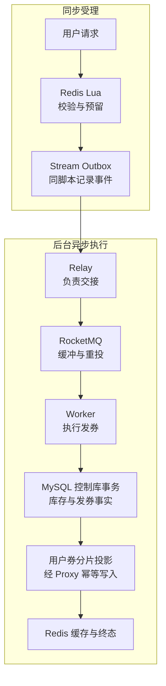

# FlashCoupon 面试核心

目标是讲清“为什么这样设计、失败后由谁处理”，不背函数清单。资料导航见 [README](README.md)。以下事实核对了当前源码、SQL、分片配置和已有工件；没有把可选优化写成已实现功能。

## A. 项目介绍

### 45～60 秒精简版

FlashCoupon 是面向多商户营销的优惠券后端，支持抢券、名单发放和订单核销。核心难点是多人同时抢有限库存，以及消息或进程失败后不能多发、漏发。入口用 Redis 原子校验和预留库存，同时留下待发送事件，后台再交给消息队列和发券进程。最终库存和发券事实由数据库事务保证，用户券另做幂等投影，失败通过重试与对账收敛。实测 5000 个用户竞争 2500 张券没有超发；双队列对照完成 42 轮、一共 42000 张券，最终账目一致。不过异步主要改善受理和削峰，没有证明最终发券更快，当前也只是单机逻辑分片验证。

### 1～2 分钟标准版

FlashCoupon 是面向多商户营销的优惠券后端，支持模板管理、限量领取、名单发放、优惠计算和核销。我重点解决两个问题：大量用户同时抢券不能超发；请求重试、消息重复或进程重启后，仍要得到一致的发券结果。

如果所有请求直接争用数据库库存行，用户会等待数据库处理；如果先扣 Redis 再单独发消息，中间崩溃又可能丢任务。因此入口用一个原子脚本完成校验、库存预留和待发送事件写入，先返回受理结果。Relay 把事件交给 RocketMQ，Worker 再完成数据库发券，避免 HTTP 请求一直等落库。

最终库存、用户限领和发券事实在控制库同一事务内提交，随后把用户券幂等写到分片表。后续失败只补齐未完成步骤，不撤销已成功的发券；明确业务拒绝才退回预留库存。定时对账负责补投和修复差异，核销则用数据库条件更新与订单唯一约束防重复。

实测 5000 用户竞争 2500 张券无超发。同步与异步的三轮对比中，受理 QPS 约从 266 提升到 2137，但最终 TPS 约从 265 变成 218，所以收益是受理和削峰，不是最终吞吐提升。另做了双队列与 Stream 直连对照，支持释放已转发载荷，但没有证明总内存或正常吞吐更好。当前是单 MySQL 内的逻辑分片，尚未验证生产高可用。

## B. 一条完整流程

用户请求先经 API 鉴权和限流，Lua 成功后返回 202；Stream 之后不依赖原 HTTP 请求存活。Relay 只负责把任务可靠交给 MQ，不执行发券事务；Worker 核对原始预留，提交事实，再补齐用户券和 Redis 状态。**202 是受理，控制库 issued 是事实成功，投影完成后才有面向用户的券数据。** 查询 issued 时，投影仍可能短暂落后。图是异步成功主线；永久拒绝转 failed 并补偿，暂时错误留给重试。同步直发和批次入口见 E，不要混入这条主线。

## C. 三个核心难点与取舍

| 难点 | 业务问题 → 普通方案不足 | 项目如何解决、为什么选它 | 代价与限制 |
|---|---|---|---|
| 库存竞争与削峰 | 多人读到同一份库存可能超发；全部直接锁数据库会排队等待 | Lua 原子预留并写事件，先限制可受理数量；后台事务完成最终发券，将等待移出 HTTP | 不是取消数据库工作；模板行锁仍限制最终 TPS，Redis 也有单主资源成本 |
| 消息可靠交接 | Redis 扣减后直接发 MQ，两个远程操作之间会留丢任务窗口；确认丢失又可能重复 | Outbox 与预留同脚本写入；Relay 确认发送后才 ACK；Worker 幂等消费，并保留对账补投依据 | 接受重复投递，不能称 exactly-once；双队列增加确认、刷盘、重连和运维成本 |
| 事实与投影一致 | 控制事实与用户券是两次写入，前者成功不代表后者成功 | 本地事务先锁定库存事实，保存券快照；投影可重放，重试/对账补齐，避免引入跨库原子事务 | 存在短暂不可查窗口；已核销历史丢失需要备份恢复，不能靠初始券快照无条件重建 |

**为什么不是只用 Stream + Worker？** 单层方案可以实现，而且仓库确有测试专用直连模式，共用相同预扣与发券逻辑。保留 MQ 的工程动机是将后台发券消费与 Redis 待发送队列分开：Broker 正常时，SQL 慢不妨碍 Relay 交接并清掉已确认载荷。Outbox 解决的是“预留与事件同写”，MQ 承担交接后的缓冲和消费重投，两者不是同一职责。

选择必须接受负结果：[双队列三轮正常负载](QUEUE_EXPERIMENT.md)的最终 TPS 为 MQ 230.20、直连 230.10，未证明更快；45 秒锁阻塞结束前，MQ 的 Stream 为 0 条，直连为 2000 条（含补投重复），最终均只发 1000 张。实验支持载荷释放，却未证明 Redis 总峰值内存下降；Broker 故障时消息仍留 Redis，还多了一个故障依赖。这是当前架构的取舍，不是单层方案做不到可靠发券。

## D. 机制与职责总览

### 数据库：什么才是事实

以下均在**一个物理 MySQL 实例**；建表依据 [001-init.sql](../deploy/mysql/001-init.sql)。

| 位置 | 业务作用 | 触发场景 | 负责组件 |
|---|---|---|---|
| control.templates | 活动规则、SQL 剩余库存、Redis 初始化标记 | 建模板、发券事务、预热 | API / Worker 的 Store |
| control.grants | 事件的 issued/failed 事实；成功券快照 | 首次发券或重放查结果 | Worker；同步直发由 API 执行 |
| control.user_limits | 同商户、模板、用户已发数量 | SQL 最终限领 | 控制库事务 |
| control.batches / batch_items | 导入批次和逐用户 accepted/rejected 进度；最终 issued 关联 grants 查 | 名单导入、后台处理和查进度 | API / 批次 Worker |
| coupon_0、coupon_1 的 coupons_0/1 | 四张用户券表，含核销状态与订单 | 投影、用户查询、核销 | Worker / API，经 Proxy |
| 两逻辑库的 merchant_templates_0/1 | 四张商户模板投影表 | 创建、状态变更、初始化或对账修复 | Service / Store；当前模板主查询仍回 control |

无 Proxy 开发模式使用 control 内 coupons、merchant_templates 表，不是另一套已验证物理扩容方案。路由按用户或商户 ID：库 `%2`，表 `floor(ID/2)%2`，见 [分片配置](../deploy/sharding/database-coupons.yaml)。

### Redis 与 Lua：不同结构不要混称“缓存”

| 位置 | 业务作用 | 触发场景 | 负责组件 |
|---|---|---|---|
| 活动 meta/stock/users/reservations/states/revision | 受理规则、预留库存/用户计数、完整事件、业务终态和版本 | 抢券、终态处理、恢复 | API / Worker；这是账本，不是可随意清空的缓存 |
| fc:outbox、消费组 relay | 待交接载荷及消费组 PEL | 抢券入队、交接失败/重启 | Relay |
| 批次 Set / fc:batch-outbox | 同批名单去重与逐用户排队 | xlsx 导入 | API / 批次 Worker |
| 模板缓存、Bloom 位图、空值、令牌锁 | 减少无效回源及热点重复重建 | 模板查询 | API / Service |
| 用户券详情、ZSet、ready 标记 | 缩小结算候选并批量读取 | 优惠报价、缓存丢失 | API；发券/核销后回读刷新 |
| 限流键、维护租约、重试标记、死信 Stream | 控制请求/扫描/补投频率，保留异常消息 | 高频请求、维护、坏消息 | API / Relay / Worker；不是自动告警系统 |

| Lua 位置 | 业务作用 | 触发场景 | 负责组件 |
|---|---|---|---|
| [claim.lua](../internal/app/lua/claim.lua) | 校验、请求去重、预扣/限领、预留及 Outbox 同写 | 异步领取 | API；批次 Worker 复用 |
| [limit.lua](../internal/app/lua/limit.lua) | 固定秒窗口计数与过期 | 用户接口请求 | API，不是令牌桶 |
| [warm.lua](../internal/app/lua/warm.lua) | 初始化库存，拒绝部分旧账本重置 | 首次预热；SQL 标记另由 Go 先持久保存 | Service.Warm |
| [finalize.lua](../internal/app/lua/finalize.lua) | pending 转终态；failed 才回补一次库存/用户计数 | SQL 明确结果后 | Worker 的 Finalize |
| [cleanup.lua](../internal/app/lua/cleanup.lua) | 全组已读游标 + PEL 原子检查后 XDEL；单轮最多 128 条 | 后台每 100 ms 尝试清理 | Relay；直连测试模式由 Worker 执行 |
| [batch.go](../internal/app/batch.go) 内联 batchEnqueue | Set 去重和批次 Stream 入队同写 | 导入每个合法用户 | API |
| [recovery.go](../internal/app/recovery.go) 内联 repairInventory | revision 未变且库存/meta 存在才修计数 | 对账修复 | Worker / 管理接口 |
| [cache.go](../internal/app/cache.go) 的解锁 Eval | 比较随机令牌再释放重建锁 | 模板回源结束 | Service.Template；没有锁自动续租 |

### 幂等：重复的对象不同

| 位置 | 业务作用 | 触发场景 | 负责组件 |
|---|---|---|---|
| eventID + reservations | 同一商户/用户/模板/request_id 返回原事件，不再预扣 | HTTP 响应丢失后重试 | API / Lua |
| users 与 SQL user_limits | 换 request_id 仍不能绕过限领；这是业务限领，不只是请求幂等 | 同用户多次请求 | Lua + Grant 模板锁内检查 |
| grants 主键 | 同事件只有一个最终事实，不重复扣 SQL 库存 | MQ 重投、补投、提交后重启 | Store.Grant |
| coupons 主键及重复插入不改状态 | 重复投影不多发、不覆盖已核销状态 | 事实成功后投影重试 | Store.ProjectCoupon |
| states 的终态检查 | 同一失败不会多退 Redis 库存 | 补偿重复执行 | finalize.lua |
| 批次 Set、稳定 batch 请求 ID、batch_items 主键 | 分别防同批重复名单、重复预留、重复进度 | 批次重复消费 | Import / processBatch；重传文件是新批次 |
| 条件 UPDATE + UNIQUE(user_id,order_id) | 同券同订单重试成功，其他订单/同单第二张券冲突 | 并发核销或响应丢失 | Store.Redeem；不是全平台订单唯一 |

关键实现：[cache.go 的 Claim/Deliver](../internal/app/cache.go)、[store.go 的 Grant/ProjectCoupon/Redeem](../internal/app/store.go)。

### 确认与删除：四个阶段

| 位置 | 业务作用 | 触发场景 | 负责组件 |
|---|---|---|---|
| MQ SendOK | Broker 发送确认；不代表用户已拿到券 | SendSync 成功返回 | MQ → Relay |
| Outbox XACK | 结束该组此条 PEL 等待，表示已交接 | SendOK 后；坏消息另需先留死信 | Relay；ACK 本身不删除载荷 |
| ConsumeSuccess / RetryLater | 正常事件最终处理完成才确认；暂时失败请 MQ 重投 | Deliver 含投影/缓存/终态完成；坏消息先留死信 | Worker → MQ |
| Outbox XDEL | 删除全部当前消费组已确认的载荷，不删预留 | 原子清理校验通过 | 后台清理器；无 relay 组或超过 8 组停删 |
| 批次 XACK | 该用户受理/拒绝进度已保存，不是券已发出 | processBatch 成功 | 批次 Worker |
| 测试直连 XACK | 直接 Deliver 完成，不是 MQ 交接 | TEST_STREAM_WORKER 模式 | 测试 Worker；不能套用默认 Relay 的 ACK 含义 |

**PEL Pending 是消息被消费组取出但未确认；业务 pending 是预留尚未收敛为 issued/failed。** Relay ACK 后，PEL 可清零，但 MQ 中仍可能积压，业务依然 pending。Stream ID 对应队列记录，事件 ID 对应业务请求；对账可给同一事件新增另一条 Stream 记录。

### 重试、恢复与补偿：看失败性质

| 位置 | 业务作用 | 触发场景 | 负责组件 |
|---|---|---|---|
| SendSync / readOutbox | 本次发送有 Producer.WithRetry(2)；外层失败不 ACK，空闲至少 10 秒由 XAUTOCLAIM 接管 | 发送失败、确认丢失、Relay 崩溃 | Relay；不是整个任务只试两次 |
| MQ 消费回调 | 30 秒处理期限；错误返回 RetryLater | SQL、Proxy、Redis 暂时失败 | Worker / MQ；期限不是重试次数上限 |
| batchWorker | 不保存临时错误为永久拒绝，不 ACK；10 秒空闲接管 | 库存暂不可读或批次进程中断 | 批次 Worker |
| finalize.lua | SQL 提交 failed 后，仅一次退 Redis 预留 | 库存耗尽、限领等明确业务拒绝 | Worker；SQL 已 issued 的投影失败只能重试，不能退款 |
| ReconcileFor / RepairProjection | 对照库存、issued、投影与预留；补缺失投影/模板投影，补投旧 pending，用 CAS 修 Redis 库存和用户计数 | 每 15 秒维护尝试，或管理接口主动触发 | Worker / Service；任务预算 12 秒、租约 14 秒，不保证每轮完成 |
| 对账补投标记 | pending 至少 15 秒才考虑补投，SET NX 的 30 秒标记减少重复频率 | MQ 已有任务也可能再次补投 | 对账任务；不是 30 秒后退库存 |
| AOF / 初始化保护 | 已初始化库存缺失就拒绝重新开放，先恢复持久账本再核对 | Redis 重启或完整账本丢失 | Redis 持久化 + Warm；不能仅按 SQL 剩余量重置 |

源码：[messaging.go](../internal/app/messaging.go)、[outbox.go](../internal/app/outbox.go)、[recovery.go](../internal/app/recovery.go)。**未实现“Relay 固定总次数后触发告警”。** 当前有日志与指标，没有自动通知链路；反复补投是恢复尝试，不是“长期自动退库存”。重试依赖存储、运行进程和任务预算，不能承诺无限可靠或最终必达。若要回答 MQ 内部默认重试上限/死信时序，需另核 SDK 与 Broker 配置；本材料不把它当已验证项目能力。

## E. 对照简历的五项设计

| 设计 | 用通俗语言解释问题与办法 | 一个可能的追问 |
|---|---|---|
| 高并发抢券与异步削峰 | 先判断有没有资格和库存，再排队落库；Lua 同写预留和事件，不让 HTTP 等数据库完成 | 为什么 Redis 预扣后仍需要 SQL 限领？ |
| 可靠消息与最终一致性 | 交接允许重做，业务结果不能重复；本地事务先记事实，投影可补齐 | SQL 提交后进程死了怎么办？ |
| 消息链路与内存治理 | 全部消费组确认后才删 Outbox 载荷，保留账本供恢复；减载荷不等于总内存下降 | 为什么 ACK 后能清理，又能重新补投？ |
| 分片与缓存优化 | 按用户找券、按商户组织模板投影；Bloom/空值/互斥重建减少无效回源，ZSet 与 Pipeline 服务报价 | 为什么四张券表没有解除模板行锁瓶颈？ |
| 批量发放与幂等核销 | Excelize 流式读名单，同批去重后复用抢券；核销由 SQL 条件和订单唯一键裁决 | 同批 accepted=100 是否等于 issued=100？ |

批次解析在 API 导入请求内，不是后台文件解析服务；非法行可导致 partial，此前已排队行继续。优惠计算只给单券方案、不叠加、不锁券；缓存报价过时也必须由 SQL 重新判断核销。Go 深挖只先掌握：最多 8 个计算 goroutine、局部结果合并时加锁、WaitGroup 等待、context 控制取消和期限，见指南第 5.6 节，不必先通读 SDK。

## F. 八个必须能口述的追问

从[项目指南第 7 节](PROJECT_GUIDE.md#7-面试复习)选取原题 1、2、3、4、7、8、9、13。每题用下面的因果关系展开到 30～60 秒，不用函数名开场。

### 1. 怎么证明没有超发？

要同时约束受理和最终落库，不能只看 Redis 不为负。入口原子限制预留，数据库锁住模板，在事务里检查库存、限领并保存事实；重复事件再来只读原结果。验证要等业务 pending 排空，再检查初始库存等于 SQL 剩余加 issued、issued 等于券投影数、Redis 剩余等于 SQL 剩余。5000 用户争 2500 张最终 2500 张是已有证据，但不是所有故障下都正确的形式化证明。

### 2. 为什么不用 Redis 扣完直接发 MQ？

因为扣库存和发远端消息不能在一个本地原子操作里完成，进程中断可能留下没有任务的预留。项目先把事件与预留同脚本写到 Stream，Relay 再交给 MQ；交接失败保留记录，确认丢失就允许重发。单层 Stream Worker 也是可行方案；双层的实测价值是 SQL 受阻时能释放已转发载荷，没有证明正常吞吐更高，还要付出 Broker 故障和重投成本。

### 3. 消息重复了怎么办，是 exactly-once 吗？

保证的是重复执行不重复产生业务效果，不是消息只到达一次。同请求生成稳定事件 ID，数据库用唯一事实与事务防重复扣库存；投影按券主键插入，已有券不会被重置成可用。另一个层次是用户限领：换请求 ID 也不能多领，需要 Redis 计数和事务内用户计数约束。补偿、批次进度、订单核销也各有幂等，不能用一个“加唯一键”概括全部。

### 4. 确认和补偿应该什么时候做？

确认表示当前组件完成了自己的责任。Relay 得到 MQ 发送确认后才 ACK Stream；正常事件的 Worker 要完成发券后续步骤才确认消费，错误则重试。超时可能发生在 SQL 已提交之后，不能当作发券失败退库存。只有控制库明确提交 failed，才把 Redis 的业务 pending 转 failed 并退一次；SQL 已成功但投影没写上，只补投影，不退已发库存。

### 5. SQL 有事实，用户为什么还看不到券？

这是事实先提交、用户券随后投影的最终一致性窗口，不是两笔独立发券。项目没有使用跨库原子事务，而是保存不可变券快照，让消费重试和对账补齐缺失投影。这样减少跨库协调，但查询 issued 不保证投影已经可见。重放投影不能覆盖已有核销状态；如果已核销数据真的损坏，要恢复备份，不能只拿初始快照变回可用券。

### 6. 对账怎么避免把新请求覆盖掉？Redis 丢了怎么办？

修复必须判断扫描快照是否过时。项目扫描前记 revision，修库存和用户计数时比较版本；抢券或终态变化使版本改变，就放弃这次旧快照修复。对账还能补投旧 pending 和修缺失投影，但不是任意数据灾难的恢复器。完整 Redis 账本丢失时关闭受理，先恢复持久数据，不能只读 SQL 剩余量重新初始化，因为可能还有已受理但没落库的任务。

### 7. 同一张券或同一订单并发核销怎么办？

最终 SQL 更新要带可用状态、用户、商户、有效期和门槛条件，而不是“先查可用就一定能改”。同券同订单重试返回成功，其他订单冲突；用户与订单的联合唯一键又防同一用户一单用两张券。报价只提供候选，不预占券。SQL 已改成功但缓存刷新失败，客户端仍要用原券原订单重试；真实订单归属和金额由可信订单服务验证，本项目没做支付。

### 8. 异步受理快了，为什么最终 TPS 没提高？

因为提前返回没有减少最终必须完成的 SQL 和投影工作。11 月 9 日的三轮对照各 500 请求、30 VU：同步/异步受理约 266/2137 QPS，P95 约 122/32 ms，但最终 TPS 约 265/218。最终窗口包含消息排空和轮询等待；模板行锁、事务、投影和消息确认仍有成本。11 月 11 日另一个 1000 请求、100 VU 的对照是 MQ 与 Stream 直连，不是同步与异步，不能把两组数字拼成同一性能提升。

其余原题 5、6 的补偿/限领已并入第 3、4 题；原题 10～12 的分片、缓存和 Go 并发，以及原题 14 的进一步实验取舍，直接查[原问答](PROJECT_GUIDE.md#7-面试复习)，不再重复背另一套长答案。

## G. 术语速查

| 术语 | 在本项目中的含义 |
|---|---|
| 预扣 / 预留 | Redis 先占一个受理名额，尚不等于 SQL 已发券 |
| Outbox | 与预留同脚本保存的待发送事件，补上“扣了库存但没发消息”的窗口 |
| PEL Pending | 消费组已取出却未 ACK 的队列记录；与业务 pending 分开判断 |
| 业务 pending | 预留尚未完成终态处理；可能已在 MQ，甚至已有 SQL 事实但后续未完成 |
| ACK / 发送确认 | 分层交接证明；必须问清是谁向谁确认，不能直接推成最终券已可用 |
| 幂等 | 同一操作重做，业务效果不重复；不意味着请求或消息只执行一次 |
| 重试 / 补投 | 暂时失败或结果不确定时再处理同一事件，不是新领一张券 |
| 补偿 | SQL 明确拒绝后退回 Redis 预留，终态检查确保只退一次 |
| 事实 / 投影 | grants 记“已发什么”；用户券表承载查询及核销，事实快照用于补齐未完成投影 |
| 最终一致性 | 允许中间状态短暂不同，通过重放和核对收敛；不是无条件保证一定恢复 |
| 削峰 | 突发请求先排队，后台按处理能力消化；未消灭工作量或排队成本 |
| CAS | 版本没变才修复计数，防旧扫描结果覆盖新抢券 |
| 逻辑分片 | 一个 MySQL 内按规则分库表；不是增加物理机器后的扩容证明 |
| QPS / 最终 TPS | 前者统计受理响应，后者统计唯一最终券及完整排空窗口；不能互换 |

## 证据边界：最后自检

已核对：[基础性能与故障报告](VALIDATION.md)、[42 轮双队列工件](../evidence/queue-isolation-2026-11-11/summary.json)、[最终审计](../evidence/queue-isolation-2026-11-11/verification/final-audit.json)。所有数字都属于已记录负载和单机环境，本次文档整理没有重跑实验。

开口前检查：是否把 202 说成发券成功？把 PEL 清空说成业务排空？把 ACK 说成删除？把“重试”说成“持续退库存”？把消费并发说成线性扩容？把有指标说成有自动告警？这些都不能这样表述。未来归档、自动告警、物理扩容与生产 HA 属于后续设计/验证范围，不是当前已实现成果。
