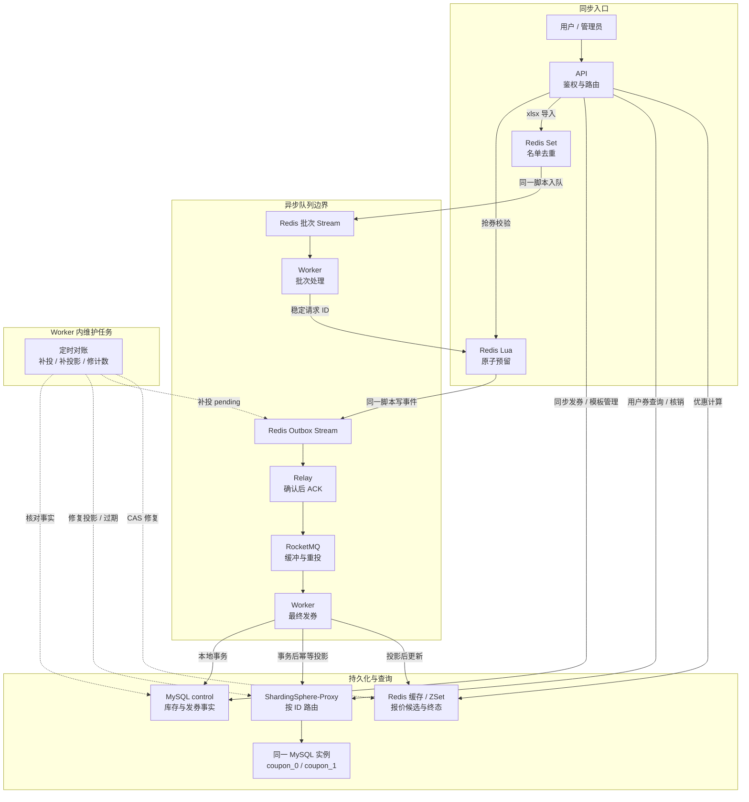
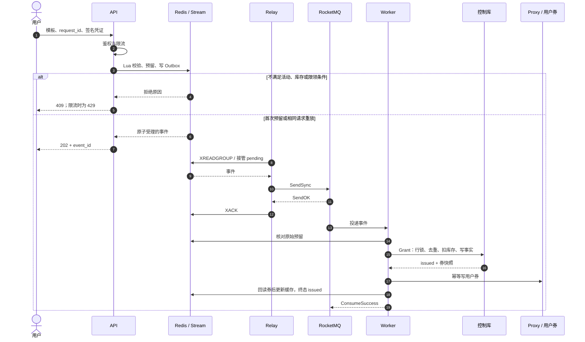
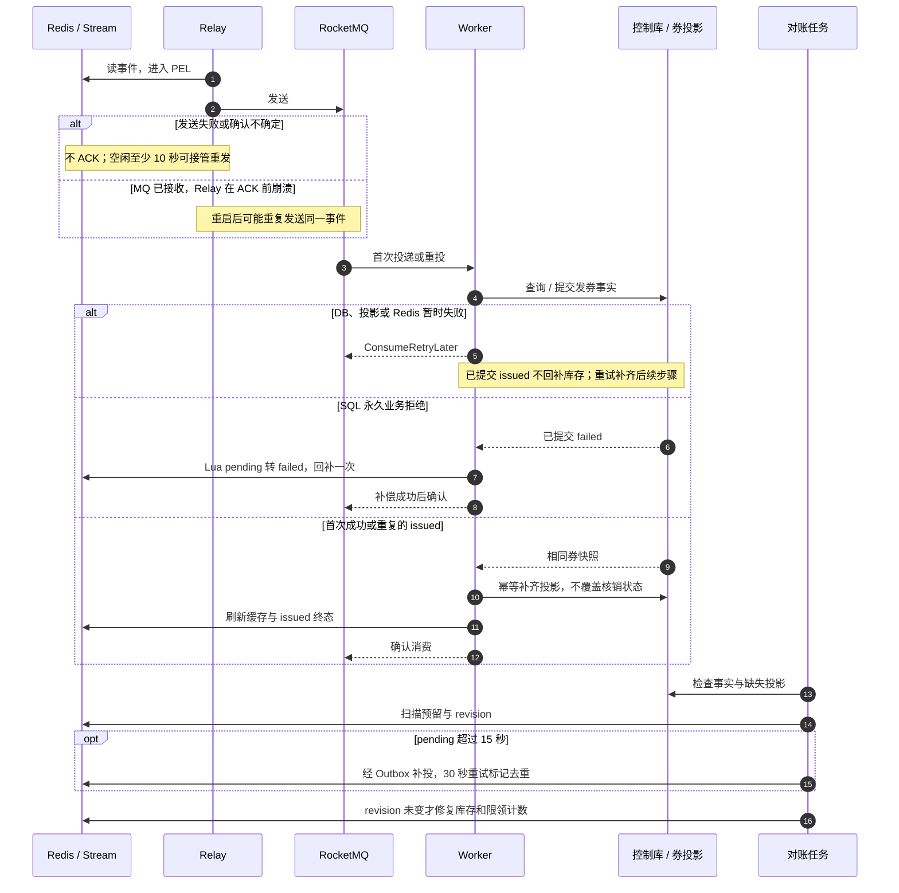
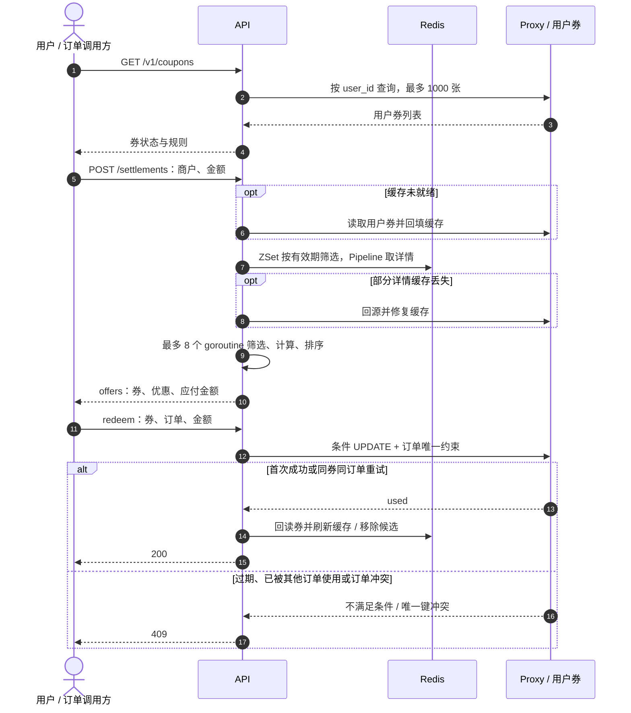

# FlashCoupon 项目学习与面试指南

面向具备 Python 开发基础、刚接触 Go 后端的读者。建议先读第 1～3 节建立业务与数据流认识，再结合第 4 节定位源码，最后用第 5～7 节理解取舍和复习。

基础验收基线：代码提交 `5d10707`；基础数据来自 [2026-11-09 工程验收工件](../evidence/engineering-2026-11-09/)。部署、指标细节见 [ARCHITECTURE.md](ARCHITECTURE.md)，基础结果见 [VALIDATION.md](VALIDATION.md)。新增 Outbox 清理及 Stream 直连对照的实现、测试与新实验见 [双队列实验报告](QUEUE_EXPERIMENT.md)，未覆盖旧工件。本文中的“投影”指把控制库中的发券事实复制成面向用户查询和核销的数据，不是另一笔发券。

## 1. 项目概览

### 业务背景与功能边界

商户创建“满 10 元减 2 元、限发 500 张、每人最多 1 张”的券模板，用户领取后得到自己的优惠券，购物时先查询可用优惠，再用订单核销。难点在于：许多人同时争抢不能超发，同一请求重试不能重复发券，消息与进程随时可能失败，而且“已经受理”和“券已可用”之间存在时间差。

| 业务 | 输入与输出 | 与其他流程的区别 |
|---|---|---|
| 模板管理 | 商户、库存、门槛、优惠、时间窗口 → 模板 | 模板是规则，用户券是领取结果；发布后核心金额、库存和时间不可变，支持暂停/恢复 |
| 普通同步发券 | `mode=direct` 模板、请求 ID → 发券结果 | `/v1/claims/direct` 在 HTTP 请求内执行 SQL 事务、券投影和缓存；也是性能对照基线，并非任意模板的降级入口 |
| 高并发抢券 | `mode=async` 模板、请求 ID → 202 和事件 ID | `/v1/claims` 先预留库存并排队，后台完成发券；202 不代表最终成功 |
| 批量发券 | xlsx 首表首列用户 ID → 批次 ID、进度 | 导入去重后由后台逐人调用同一抢券链路，不直接绕过库存与限领 |
| 优惠计算 | 用户、商户、订单金额 → 可选券及应付金额 | 计算单券方案并排序，不叠加优惠，不锁定券，也不扣库存 |
| 核销 | 券、商户、订单 ID、金额 → 已使用券 | SQL 最终裁决可用性；同券同订单重复请求成功，冲突订单拒绝 |

用户身份来自 HMAC 签名凭证，管理员使用管理密钥，不能通过请求体冒充其他用户。金额统一使用整数分；本项目不实现商品、支付或真实订单校验，订单归属与金额应由可信订单服务提供。[接口实现](../internal/app/http.go)：`Router`、`SignToken`、`VerifyToken`；[模型与校验](../internal/app/model.go)：`Template.Validate`。

### 用七句话建立架构认识

1. Gin 提供 HTTP 接口，Go 服务按 `ROLE` 拆成 API、Relay、Worker 三个独立进程，使用同一份镜像。
2. API 先鉴权和限流，再用 Redis Lua 一次完成活动检查、库存预扣、用户限领、请求去重与 Stream 写入。
3. Redis Streams 是与预留账本一起写入的本地待发送箱（Outbox），避免“扣了 Redis 库存，却没发出消息”的两步操作窗口。
4. Relay 读取 Stream，把事件发送到 RocketMQ，只有确认发送成功才 ACK；Worker 消费 MQ 并执行最终发券。
5. MySQL 控制库的本地事务原子提交库存、用户领取计数与发券事实，用户券则经 ShardingSphere-Proxy 幂等写入分片投影。
6. Redis 还负责模板缓存和优惠计算候选索引，Excelize 负责名单流式读取，Worker 内维护任务负责补投、投影修复、计数对账与过期流转。
7. Docker Compose 负责启动依赖和进程部署，Prometheus 格式指标、Go 测试、故障脚本与 k6 工件提供可检查的工程证据；当前存储仍是单个物理 MySQL 实例。

## 2. 整体架构图



图中多个 Redis 节点是同一 Redis 服务中的不同数据结构；两个优惠券逻辑库和 `control` 都位于同一 MySQL 实例。实线表示请求或数据流，虚线表示维护任务；从 Stream 开始，处理不再依赖原 HTTP 请求持续在线。Worker 的发券消费、批次处理和维护任务属于同一进程中的不同任务，不是三种额外服务。

| 组件 | 存在的原因 | 关键边界 |
|---|---|---|
| API | 把用户请求转成经过鉴权、限流的操作 | 抢券不等待 MQ；自身启动仍依赖 Redis、数据库及分片模式的 Proxy |
| Redis / Streams | 快速判断能否受理，并留下可恢复的预留及待发事件 | 不是最终发券数据库；完整库存账本丢失时关闭受理 |
| Relay / RocketMQ | 解耦 Redis 预留与发券消费者，让发送、消费分别恢复 | 采用可重复投递语义，需要业务幂等；增加了一次中转和确认成本 |
| MySQL / Proxy | 保存权威事实和核销状态，把用户查询按分片键路由 | 控制库事务与用户券投影不在一个跨库原子事务中 |
| Worker / 对账 | 把预留变成券，并收敛处理中断留下的中间状态 | 对账负责修复可恢复状态，不代替备份或磁盘容灾 |

配置入口：[compose.yaml](../compose.yaml)、[compose.sharding.yaml](../compose.sharding.yaml)、[启动代码](../cmd/server/main.go)。每个进程都有健康检查与 `/metrics`；只有 API 暴露业务路由。健康就绪检查数据库与 Redis 连通性，不代表 MQ 已排空或所有业务账目一致。

## 3. 核心业务流程

### 3.1 用户抢券到最终发券



输入中的用户 ID 从凭证取得；事件 ID 是商户、用户、模板、请求 ID 的 SHA256。相同请求返回原事件，不再扣库存；不同请求仍受每用户限领约束。图展示成功消费，SQL 拒绝和基础设施错误见下一图。库存未初始化返回 503；模板不存在可返回 404。

输出有两个层次：202 表示 Redis 已受理；`GET /v1/claims/:id` 返回控制库的 `issued/failed`，事实未写入时可能暂时 404。即使查到 `issued`，用户券投影也可能尚未完成；查看用户券或等待审计排空，才能确认完整链路收敛。活动是否按时受理以 Redis 时间戳为准，已合法受理的消息可在活动结束后处理，券使用仍受有效期约束。

源码：[Claim / Deliver](../internal/app/cache.go)、[claim.lua](../internal/app/lua/claim.lua)、[relay / StartMessaging](../internal/app/messaging.go)、[Grant / ProjectCoupon](../internal/app/store.go)。

### 3.2 失败、重试、补偿与对账



PEL（Pending Entries List）是消费组里“取出但未确认”的消息清单；`XACK` 本身仅确认消费；独立后台随后仅删除所有现存消费组均已确认的 Outbox 载荷，未读与 PEL 消息保留，预留账本不删除。确认丢失会产生重复，数据库幂等负责让重复执行没有重复业务效果，不能称为消息只投递一次。

永久失败指 SQL 已明确判定库存耗尽、用户超限等并提交 `failed`；暂时连不上数据库、超时或投影失败无法证明业务失败，只重试。对账依据持久事实和预留账本修复，CAS（比较后更新）要求扫描前后的 revision 一致，防止旧快照覆盖新抢券。坏消息先写 `fc:deadletters` 再确认；完整 Redis 账本丢失不属于自动重建范围。

源码：[消息与 ReconcileFor / Maintenance](../internal/app/messaging.go)、[repairInventory / RepairProjection](../internal/app/recovery.go)、[finalize.lua](../internal/app/lua/finalize.lua)。

### 3.3 查询、优惠计算与核销



列表查询直接走 SQL；结算才使用缓存候选。报价输出按优惠从高到低排序的单券方案，不预占券，所以提交核销时必须重新校验。核销更新同时检查用户、商户、状态、有效期与门槛；唯一键作用域为“同一用户、同一订单”，不是全平台全局订单去重。

SQL 核销成功但缓存更新失败时，接口可能返回 503；客户端应使用同券、同订单重试，不应换订单重做。暂时过时的报价不能绕过 SQL 核销裁决。源码：[Settle / Offers](../internal/app/settlement.go)、[UserCoupons / Redeem / Expire](../internal/app/store.go)、[CacheCoupon](../internal/app/cache.go)、[HTTP 错误映射](../internal/app/http.go)。

## 4. 核心模块与源码导航

所有核心业务集中在 `internal/app` 包中；文件按职责拆分，并非每个文件都是一个独立微服务。HTTP 层解析请求并调用 `Service`，`Service` 组合 Redis 与 `Store`，`Store` 负责 SQL。读代码时优先追一条业务调用链，不必逐行阅读 SDK。

| 模块 | 职责 | 关键文件 / 函数 | 依赖 |
|---|---|---|---|
| 启动与配置 | ROLE、信号、HTTP 排空、资源关闭 | [main.go](../cmd/server/main.go)：`main`；[model.go](../internal/app/model.go)：`LoadConfig` | Compose、context |
| HTTP 与身份 | 路由、签名、输入约束、状态码、限流入口 | [http.go](../internal/app/http.go)：`Router`、`VerifyToken` | Gin、Redis |
| 模板与预留 | 缓存、预热、领取、消费编排、终态 | [cache.go](../internal/app/cache.go)：`Template`、`Warm`、`Claim`、`Deliver` | Redis、Store |
| 原子脚本 | 预留、限流、初始化、一次性补偿 | [claim.lua](../internal/app/lua/claim.lua)、[limit.lua](../internal/app/lua/limit.lua)、[warm.lua](../internal/app/lua/warm.lua)、[finalize.lua](../internal/app/lua/finalize.lua) | 单 Redis 主节点 |
| 事务与投影 | 库存事实、限领、券落表、查询与核销 | [store.go](../internal/app/store.go)：`Grant`、`ProjectCoupon`、`Redeem` | database/sql、MySQL、Proxy |
| 消息链路 | Stream 接管、发送确认、MQ 消费、关闭等待 | [messaging.go](../internal/app/messaging.go)：`StartMessaging`、`relay`、`Messaging.Close` | Streams、RocketMQ |
| 批次 | 流式导入、原子去重入队、幂等进度 | [batch.go](../internal/app/batch.go)：`Import`、`processBatch`、`batchWorker`、`Batch` | Excelize、Redis、控制库 |
| 优惠计算 | 缓存候选加载、有界并发计算 | [settlement.go](../internal/app/settlement.go)：`Settle`、`Offers` | ZSet、Pipeline、sync |
| 对账与恢复 | 重投、库存核对、投影修复、过期任务 | [messaging.go](../internal/app/messaging.go)：`ReconcileFor`、`Maintenance`；[recovery.go](../internal/app/recovery.go)：`RepairProjection`、`repairInventory` | SQL、Redis |
| 可观测性 | HTTP 延迟、终态事实、积压与任务新鲜度 | [metrics.go](../internal/app/metrics.go)：`NewMetrics`、`collect` | Prometheus client |
| 数据布局 | 表约束与按键路由 | [001-init.sql](../deploy/mysql/001-init.sql)、[database-coupons.yaml](../deploy/sharding/database-coupons.yaml) | InnoDB、Proxy |

**推荐源码阅读顺序：** `model.go` → `http.go` 的领取路由 → `Claim` 与 `claim.lua` → `relay` → `Deliver` → `Store.Grant` → `ProjectCoupon` → `ReconcileFor`。再用 `Settle/Redeem` 和 `Import/processBatch` 补齐使用券、批量券两条分支。

对 Python 读者：Go 的 `struct` 可先理解成明确字段类型的数据类，方法接收者如 `(s *Service)` 表示操作服务实例，`(value, error)` 是显式错误返回。`context.Context` 传递取消和期限；`defer` 安排函数退出清理，类似 `try/finally`，但要留意关闭顺序。这里的 goroutine 可并行读共享内存，不能把它当作“不会发生共享内存竞态的 asyncio 协程”；并发资源管理见 5.6。

## 5. 核心技术设计

### 5.1 Lua：原子预留、幂等与限流

**为什么需要：** 若先读库存再减一，多个请求可能读到同一份剩余数；若扣库存后再单独发 MQ，进程可能在两步之间崩溃。

**怎么实现：** `claim.lua` 先检查键类型，再检查同事件预留；首次请求按 Redis `TIME` 检查活动、库存与限领，然后扣库存、增加用户计数、保存完整事件、设置 `pending`、写 Outbox 并递增 revision。`eventID` 将同一业务请求映射到同一键，重复请求取原事件。`http.go` 调用 `limit.lua`，以当前秒作为键使用 `INCR + PEXPIRE`，默认全局 5000 次/秒、单用户 100 次/秒；这是固定窗口，不是令牌桶，限制作用于用户 `/v1` 路由，批次后台不经过 HTTP 限流。

**为什么这样选：** 单 Redis 内脚本执行期间不被其他命令穿插，让“是否接受”和“留下待发证据”成为同一步；比抢券时逐个请求争用 MySQL 热点行更快。请求幂等解决网络重试，用户限领解决“换请求 ID 多领”，二者不能互相替代。

**局限：** Lua 原子执行不等于出错自动回滚，所以脚本预检查键类型，但仍不能宣称抵御所有 Redis 运行时故障。固定窗口有边界突发，限流也不提供公平排队。现有全局 Stream 与模板键的多键脚本基于单 Redis 主节点，不是已验证的 Redis Cluster 跨槽方案。`Warm` 先写 SQL 初始化标记再暴露库存；已初始化账本丢失就关闭受理，宁可暂时不可用，也不能用 SQL 剩余量覆盖尚未落库的预留。

源码：[claim.lua](../internal/app/lua/claim.lua)、[limit.lua](../internal/app/lua/limit.lua)、[cache.go](../internal/app/cache.go)：`Warm/Claim`；[model.go](../internal/app/model.go)：`eventID`。

### 5.2 Streams + RocketMQ：两级异步与可靠确认

**为什么需要：** Redis 预留无法与远端 MQ 发送组成一个本地原子操作，需要先在预留所在系统保存事件；RocketMQ 则承担后续发券消费者的缓冲与重投。

**怎么实现：** Relay 使用消费组读 `fc:outbox`，以 `XAUTOCLAIM` 接管空闲至少 10 秒的 pending；同步发送获得 `SendOK` 才 `XACK`。Worker 属于 `fc-workers` 消费组，核对 Redis 原始预留后调用 `Deliver`；发券、投影、缓存和终态处理出错则返回 `ConsumeRetryLater`。异常消息写死信 Stream 成功后才确认。批次另有 Stream 和消费组，成功记录进度后才 ACK。

**为什么这样选：** 不把 Redis 扣减与 MQ 发送分开直接双写；确认顺序优先避免漏处理，接受重复，由业务层消重。Stream pending 只代表 Relay 未确认，不代表最终发券仍在处理；Relay ACK 后，事件还可能在 MQ 或数据库阶段等待。

**局限：** 双队列增加运行成本、重复窗口与链路延迟；当前 Relay 逐条同步等待发送确认，并非批量高吞吐转发。Redis AOF `always` 与 Broker `SYNC_FLUSH` 支持已验证的进程恢复，不等于多副本 HA 或磁盘损坏容灾。Outbox 每 100 ms 最多检查 128 条，原子核对各组已读游标和 PEL 后删除安全载荷；库存预留账本、批次和死信未自动归档。清理实现见 [outbox.go](../internal/app/outbox.go) 和 [cleanup.lua](../internal/app/lua/cleanup.lua)。

源码：[messaging.go](../internal/app/messaging.go)：`relay/StartMessaging`；[batch.go](../internal/app/batch.go)：`batchWorker`；[broker.conf](../deploy/rocketmq/broker.conf)、[compose.yaml](../compose.yaml)。

### 5.3 MySQL：事实、投影与最终一致性

**为什么需要：** Redis 预扣是受理判断，最终仍需要可审计的持久发券记录；消费重复或中途失败不能多扣库存，也不能抹掉已核销券。

**怎么实现：** `Grant` 在控制库事务内先 `SELECT ... FOR UPDATE` 锁模板，再检查 `grants.id` 是否已有结果、用户限领与库存，最后原子提交库存减一、用户计数及带券快照的 `issued` 事实；明确的业务拒绝写 `failed`。事务外 `ProjectCoupon` 使用重复键无操作插入，`CacheCoupon` 回读实际券状态后更新 Redis。只有 `failed` 终态通过 `finalize.lua` 从 `pending` 转移时退一次 Redis 库存和用户计数。

| 约束 | 业务保证 |
|---|---|
| `grants` 主键 `id` | 同事件重投只得到同一发券结果 |
| `user_limits` 主键 `(merchant_id,template_id,user_id)` + 模板锁 | 不同请求 ID 不能绕过同活动限领 |
| `coupons` 主键 `(user_id,id)` | 投影可重放，不生成第二张券 |
| `coupons` 唯一键 `(user_id,order_id)` | 同用户同订单不能使用两张券 |
| `batch_items` 主键 `(batch_id,user_id)` | 批次进度重放不重复累计 |

**为什么这样选：** 把库存相关强约束集中在一个本地事务里，不引入跨分片分布式事务；用不可变事实重放用户券投影，允许短暂延迟。SQL 已提交但后续步骤失败时，重试补齐，不把“没收到成功响应”当作“没有发券”。

**局限：** 同模板请求串行争抢一行锁，分用户券表不会消除这个热点。控制事实、用户券和 Redis 不是瞬间一致；对账读取也不是跨系统一致快照。排空后应满足：`初始库存 = SQL 剩余 + issued`、`issued = 券投影数`、异步模板 `Redis 剩余 = SQL 剩余`；处理中 Redis 应满足 `剩余 + 预留总数 - failed = 初始库存`。投影修复用于未完成的发券，不能把丢失核销历史的券重新恢复成可用券，数据损坏需要备份。

源码：[store.go](../internal/app/store.go)：`Grant/ProjectCoupon/Redeem`；[SQL 约束](../deploy/mysql/001-init.sql)；[finalize.lua](../internal/app/lua/finalize.lua)；[recovery.go](../internal/app/recovery.go)。

### 5.4 分库分表：按访问维度组织投影

**为什么需要：** 用户想看“我的券”，商户想按商户组织模板数据，查询维度不同，适合分别选择分片键。

**怎么实现：** Go 的 `Store.DB` 直连 `control`，`Store.Coupons` 在分片部署时连接 Proxy 的逻辑库 `coupons`。用户券按 `user_id`、商户模板投影按 `merchant_id` 路由；控制模板、发券事实和限领表仍集中在 `control`。当前管理员模板列表和 `Service.Template` 的回源读取仍走控制库，不能说所有模板查询已改走商户投影。

| 规则 | 结果 |
|---|---|
| 逻辑库：`ID % 2` | `coupon_0` 或 `coupon_1` |
| 表后缀：`floor(ID / 2) % 2` | `coupons_0/1` 或 `merchant_templates_0/1` |
| 用户 ID 4、5、6、7 | 分别落入库表组合 `(0,0)`、`(1,0)`、`(0,1)`、`(1,1)` |

**为什么这样选：** 数据库和表使用不同的 ID 位，能覆盖四个组合；若两层都简单 `% 2`，只能用到其中两个组合。查询和核销携带 `user_id` 可定向路由；无需 Go 手写每个物理表名。

**局限：** 一个物理 MySQL 实例内有 `control` 加两个优惠券逻辑库，用户券四表、商户模板投影四表；未证明物理多实例扩容收益。跨用户的全局计数、过期与对账会广播到分片，Proxy 自身有资源成本。无 Proxy 开发模式使用 `control` 内未分片表，已有数据不能仅改 DSN 就切换布局。

源码：[database-coupons.yaml](../deploy/sharding/database-coupons.yaml)、[001-init.sql](../deploy/mysql/001-init.sql)、[compose.sharding.yaml](../compose.sharding.yaml)、[store.go](../internal/app/store.go)。

### 5.5 缓存：保护模板查询，缩小结算候选

**为什么需要：** 不存在的模板会造成无效回源，热点缓存同时过期会引发大量相同 SQL 查询；逐张远程读取用户券又会放大网络往返。

**怎么实现：** 模板使用 Redis 位图构成 Bloom Filter（四个哈希偏移，位图空间 `2^24` 位），先快速判断“肯定不存在”或“可能存在”；后者仍需查缓存/数据库。不存在结果缓存 `null` 5 秒，正常模板缓存 60 秒；重建用 `SET NX` 加随机令牌和 3 秒租期，释放时 Lua 比较令牌再删除。用户券 ZSet 以过期时间为 score，结算先筛未过期 ID，再 Pipeline 取详情；冷缓存或详情缺失回源，ready 标记 30 秒、详情缓存 10 分钟。

**为什么这样选：** Bloom 允许误判存在，避免为所有不存在 ID 建记录；空值缓存吸收误判或重复无效请求；带令牌锁减少同时重建且避免旧持有者误删新锁。Pipeline 合并命令往返，`CacheCoupon` 的 `TxPipeline` 则额外使用 Redis 事务组合详情与索引更新，二者不能混称为同一种原子性。

**局限：** Bloom 未就绪或读取异常时放行后续检查，不把过滤器当数据库真相；位图不支持直接安全删除。重建锁没有自动续租，慢查询超过租期可能重复重建，它只是缓存保护，不承担发券正确性。ZSet 仅按时间预筛，商户、状态、门槛仍在 `Offers` 检查；缓存可以短暂过时，最终核销靠 SQL。单用户列表/候选最多 1000 张，目前没有无上限分页能力。

源码：[cache.go](../internal/app/cache.go)：`bloomOffsets/bloomMayExist/Template/CacheCoupon`；[settlement.go](../internal/app/settlement.go)：`Settle`。

### 5.6 Go 并发与资源管理

**为什么需要：** HTTP 请求、MQ 回调和后台扫描并行运行；无界创建任务或关闭时先断数据库，会引发连接耗尽、共享内存竞态或处理被截断。

**怎么实现：** `Offers` 最多启动 8 个 goroutine，各自计算局部结果，用 `Mutex` 合并、`WaitGroup` 等待后排序。Redis 池大小 100、池等待 30 秒；两个 SQL 连接池分别最多 40 个连接、10 个空闲连接，连接最长使用 3 分钟。主进程用信号 context 触发退出，HTTP 最多排空 15 秒，MQ 回调有 30 秒期限；`Messaging.Close` 通过互斥保护关闭标记和回调注册，再等待在途回调、后台任务，最后关闭生产者，服务资源随后关闭；Compose 宽限 60 秒。

**为什么这样选：** 有界并发给出明确资源上限，局部结果减少共享区竞争；context 统一传递取消，`defer` 保障清理，`sync.Once` 使关闭可重复调用。先阻止新回调再等待，可避免 `WaitGroup.Add` 与退出等待交错。

**局限：** 8 个计算协程不代表一定比串行快，当前工件没有单独证明报价并行加速比例。`-race` 只检测实际运行到的并发路径，不是无竞态证明。本项目曾真实捕获 RocketMQ Go v2.1.2 的共享订阅对象竞态，现固定本地最小补丁：克隆对象、修改副本、再发布，并保留原始 SDK 对照失败与修复后通过的回归证据。

源码：[settlement.go](../internal/app/settlement.go)：`Offers`；[store.go](../internal/app/store.go)：`OpenStore`；[messaging.go](../internal/app/messaging.go)：`Close/beginConsume`；[main.go](../cmd/server/main.go)；[SDK 补丁说明](../third_party/ROCKETMQ_PATCH.md)。

### 5.7 独立 Worker、批次恢复与对账

**为什么需要：** API 扩缩或重启不应同时中断所有后台任务，批次和未完成发券也不能依赖原导入请求仍在运行。

**怎么实现：** `ROLE=worker` 启动 MQ 消费、批次 Stream 消费和维护任务。Excelize `Rows` 流式读取名单，Lua 将 Redis Set 去重和批次入队合并；`processBatch` 用稳定请求 ID `batch:<批次ID>` 调用 `Claim`，靠 `batch_items` 主键记录进度。库存暂不可读视为可重试基础设施错误，不记永久拒绝，也不 ACK。维护每 15 秒触发一次，尝试 14 秒租约，单轮任务限时 12 秒，完成投影修复、pending 补投、revision CAS 修计数与过期状态更新。

**为什么这样选：** 所有发券共用一个库存与幂等入口，批次只负责“谁需要领取”，避免产生第二套库存规则。任务可以因重启重复执行，但重复执行不重复产生业务效果；维护租约减少多个 Worker 同时扫描。

**局限：** xlsx 导入本身在 API 请求内解析，不是后台文件解析服务；非法行导致 `partial`，此前已排队用户继续执行，没有整批回滚。Set 只在同批次去重，重传文件会创建新批次，跨批次仍靠模板限领。每请求最多 20 MiB、解压上限 128 MiB、最多 100 万数据行是保护上限，不是已验证百万行性能。对账仍扫描历史，12 秒预算可能随数据增长不足；租约也不提供任意进程停顿下的严格单执行保证，正确性仍依赖幂等与 CAS。

源码：[batch.go](../internal/app/batch.go)：`Import/processBatch/batchWorker`；[messaging.go](../internal/app/messaging.go)：`StartMessaging/Maintenance/ReconcileFor`；[recovery.go](../internal/app/recovery.go)。

## 6. 测试与性能

### 6.1 测试覆盖与证据

| 类型 | 验证目标与已记录结果 | 代码 / 工件 |
|---|---|---|
| 单元、race、静态检查 | 身份隔离、事件 ID、优惠规则、关闭等待、低基数标签、Worker 路由隔离；常规/race/vet 与 SDK 回归通过 | [app_test.go](../internal/app/app_test.go)、[metrics_test.go](../internal/app/metrics_test.go)、[tests.json](../evidence/engineering-2026-11-09/tests.json) |
| 真实中间件集成 | 200 次并发请求争 30 张，最终 30 张/30 人；覆盖重复投递、批次去重、补偿、过期、缓存/库存丢失、投影修复和大整数身份 | [integration_test.go](../internal/app/integration_test.go)：`TestIntegration` |
| 独立进程故障注入 | 100 个受理事件加 200 次重复 Stream 投递；SQL 锁等待期间杀 Worker，重启后恰好 100 张、pending=0 | [faults.py](../scripts/faults.py)、[faults.json](../evidence/engineering-2026-11-09/faults.json) |
| Broker / AOF 恢复 | Broker 停止期间受理 20，重启 Redis 及后台进程，恢复后 20 张且账目一致；该次恢复观察 10.781 秒 | 同上；不是生产恢复时间承诺 |
| 限领、补偿、核销 | 同用户 20 个不同请求仅受理 1；永久拒绝补偿重放 3 次只回补一次；20 次同券同单核销均幂等成功，2 类冲突拒绝 | 同上 |
| 批次与最终审计 | 100 人批量受理并最终发券 100；全局 198 个活动 pending=0、不一致=0 | [batch.json](../evidence/engineering-2026-11-09/batch.json)、[final-audit.json](../evidence/engineering-2026-11-09/final-audit.json) |
| 部署与 CI | 全新卷启动 37.188 秒，三角色健康、四张券表存在；实现提交远端 CI 成功 | [fresh-start.json](../evidence/engineering-2026-11-09/fresh-start.json)、[ci.json](../evidence/engineering-2026-11-09/ci.json)、[工作流](../.github/workflows/ci.yml) |

CI 使用 `INTEGRATION=0`，验证无中间件测试、race、vet 和 SDK 回归；真实中间件测试需要显式启用并单独运行。工件的 16 条 PASS 包含父测试与子测试，不代表 16 套彼此独立的测试场景。

### 6.2 性能数据应该怎样读

环境为 Docker Engine 29.8.1、28 逻辑 CPU、15.51 GiB；API、Relay、Worker 各一个，单 MySQL，AOF always、MQ 同步刷盘。三轮配对测试各 500 请求、30 VU、库存 500、每人限 1，新建模板，预热不计入，交替测试顺序。数据及环境配置见 [environment.json](../evidence/engineering-2026-11-09/environment.json)、[summary.json](../evidence/engineering-2026-11-09/summary.json)。

| 三轮中位数 | HTTP 受理 QPS | 最终发券 TPS | HTTP P95 / P99 |
|---|---:|---:|---:|
| 同步直发 | 265.82 | 265.39 | 121.76 / 129.87 ms |
| Redis 异步 | 2136.75 | 218.15 | 32.24 / 35.01 ms |

- **受理 QPS：** 成功受理响应数除以请求阶段窗口；同请求幂等重放也会多次计入响应数，不能代表新增了多少张券。
- **最终 TPS：** 唯一最终发券数除以开抢至 SQL 事实、券投影和 Redis pending 排空的观察窗口；每秒轮询一次，包含约一秒的观测粒度，不是 Worker 瞬时吞吐。
- **结论：** 此条件下异步受理约提升 8 倍、P95 降低约 74%，但最终 TPS 为 218，低于同步的 265；收益是把等待移出 HTTP、缓冲突发，不是把数据库发券能力提升 8 倍。

| 补充负载 | 最终唯一发券 | 最终 TPS | HTTP P95 / P99 | 一致性 |
|---|---:|---:|---:|---|
| 1000 VU，库存 500 | 500 | 215.89 | 119.08 / 122.20 ms | 无超发，排空后一致 |
| 5000 VU，库存 2500 | 2500 | 234.39 | 796.09 / 817.61 ms | 无超发，排空后一致 |
| 500 次请求，10 个唯一用户/请求 | 10 | 58.14 | 34.19 / 35.36 ms | 幂等重放未增发 |

1000/5000 场景使用 `per-vu-iterations`，每 VU 一个用户、一次请求，不保证所有网络包同一瞬间到达；延迟包含快速库存拒绝，不能等同于“全部成功请求的延迟”。上述九轮领取场景非预期 HTTP 错误率为 0，409/429 作为业务拒绝/限流单独计数，不代表所有请求都成功领券。

模板行锁和本地事务仍串行化热点库存；Relay 逐条等待 MQ 确认，之后还有 Proxy 投影及缓存回读，均增加最终完成成本。原始 JSON 的 `stage_latency` 保留分阶段均值/尝试数，可帮助判断等待位置，但不能仅凭均值断言唯一瓶颈，也没有证据证明增加 Worker 就能线性扩容。

5000 用户场景采样中 API 峰值 CPU 242.33% / 内存 218 MiB，Worker 57.75% / 21.23 MiB；全部测试 Proxy 采样峰值约 4.48 GiB。Docker CPU 100% 对应一逻辑核，离散峰值不一定同时出现，短测样本也不能代表长期容量。只有三轮短测，无物理多实例、HA、长稳或生产容量验证。

### 6.3 新增：双队列与 Stream 直连对照

测试专用 `TEST_STREAM_WORKER=1` 让后台直接消费 Stream，复用相同 Lua 预扣和 `Deliver`，ACK 改在最终处理完成之后；默认仍走 Relay + RocketMQ。二者都异步，不能与前表的 HTTP 同步直发混为一谈。测试模式和 Relay 不得同时运行。

[queue_experiment.py](../scripts/queue_experiment.py) 复用原 k6、审计与 Docker 工具，正常负载、模板锁阻塞、MySQL 暂停、进程崩溃、Broker 故障及清理前后按相同负载重复三轮。额外 45 秒阻塞跨越 Worker 超时和对账补投窗口，用来检验短测看不到的重试成本。分别记录 Redis used_memory、Outbox MEMORY USAGE 与目标活动账本，不能把账本保留误算为 Stream 积压。

完整新结果与负结果见 [QUEUE_EXPERIMENT.md](QUEUE_EXPERIMENT.md)。需要记住：双队列可以在 SQL 消费变慢时把已转发载荷移出 Redis，但不能移走 Redis 预留账本，也不保证 HTTP 或最终 TPS 更好；Broker 故障时积压仍回到 Redis。单主 Redis 的脚本执行成本和 MQ 的运维/刷盘/重投成本都仍存在。

### 6.4 复现与指标排查

在仓库根目录执行，需 Docker Compose 和 Python 3.10+；脚本会停止/恢复本项目进程并创建测试数据，故障与压测应串行运行。

```sh
docker compose -f compose.yaml -f compose.sharding.yaml up -d --build
python scripts/verify.py
python scripts/faults.py
python scripts/benchmark.py
python scripts/summarize.py
```

入口分别为 [verify.py](../scripts/verify.py)、[faults.py](../scripts/faults.py)、[benchmark.py](../scripts/benchmark.py)、[summarize.py](../scripts/summarize.py)，k6 场景在 [claims.js](../tests/k6/claims.js) 与 [batch.js](../tests/k6/batch.js)。无 Python 的真实集成入口为 [integration.sh](../scripts/integration.sh)。复现会更新证据文件；`manifest.json` 保存可核对的摘要，冗长日志留在忽略的 `reports/`。

三个进程 `/metrics` 的源码是 [metrics.go](../internal/app/metrics.go)，抓取示例见 [scrape.yaml](../deploy/prometheus/scrape.yaml)。排查顺序：HTTP 拒绝/延迟 → Stream unread/PEL → 端到端 pending → SQL issued 与投影数 → 对账异常和最后成功时间。HTTP 延迟 Histogram 可计算 P95/P99；发券事实是持久 Gauge，不要把消费尝试 Counter 或多 Worker 的全局事实 Gauge 求和当作唯一发券量。标签不包含用户、请求或模板 ID，避免时间序列数量随业务数据无限增长。

## 7. 面试复习

以下按重要性排序，答案聚焦项目事实；展开细节时回到第 5 节对应源码。

### 1. 怎么证明系统没有超发，而不只是 Redis 没减成负数？

Redis Lua 约束受理，SQL 模板锁、库存检查和事务约束最终发券，唯一事实与投影主键防止重复。测试必须等 pending=0，再核对初始库存、SQL 剩余、issued、投影数和 Redis 剩余；5000 用户争 2500 张最终恰好 2500 张，是已验证结果，不是对所有故障的形式化证明。

### 2. 为什么不能直接 Redis 扣库存后发 MQ？

两次远程操作之间可能崩溃，留下已扣库存但无消息的请求。项目把预留与 Stream 写入放进同一 Lua，Relay 再转发 MQ；代价是多一层队列和维护成本，换来可恢复的待发送记录。

### 3. 怎么处理消息重复？是否做到 exactly-once？

消息允许重复投递，业务效果通过幂等收敛。事件 ID 稳定，SQL `grants` 主键和事务返回原事实，用户券投影重复插入不改状态；不是端到端 exactly-once 传输，也不依赖 MQ 永远只投一次。

### 4. MQ 确认和 Stream ACK 应该放在什么位置？

Relay 收到 `SendOK` 后才 ACK；提前 ACK 会漏发，确认后崩溃则可能重复，交给业务去重。Worker 只有发券、投影、缓存和终态处理完成才确认；失败返回重试，批次也要先保存幂等进度再 ACK。

### 5. 哪些失败可以退库存？超时能不能直接退？

只有 SQL 已提交 `failed` 的永久业务拒绝才补偿，Lua 通过 `pending→failed` 保证只退一次。超时可能发生在 SQL 已提交之后，不能据此退款；已有 `issued` 只重试投影与终态，否则可能出现券已发出却把库存再次放回。

### 6. 为什么既有 Redis 限领，还要数据库限领？

Redis 在高并发入口快速拒绝，SQL 是最终事实约束。请求幂等只挡相同请求 ID，用户换 ID 仍需限领；项目在模板锁内检查复合键用户计数并提交，不能只依赖唯一事件 ID 防多领。

### 7. 控制库和分片券库怎么保证一致？

不做跨库原子事务，先保存控制库事实和券快照，再幂等投影。失败依靠消费重试及对账补齐；允许事实先于可查询券出现，不能将控制库 `issued` 直接解释为所有后续写入已完成。

### 8. 对账如何避免覆盖正在进行的抢券？Redis 数据丢失怎么办？

扫描前记录 revision，修库存/用户计数时 Lua 比较当前 revision，变更就放弃旧快照。完整账本缺失则关闭受理，不能仅按 SQL 剩余库存重新初始化，因为 SQL 可能尚未包含已受理预留；先恢复持久数据再核对。

### 9. 核销为什么“先查可用再更新”还不够？

两请求可能同时查到可用，所以最终 UPDATE 必须带状态、用户、商户、时间、门槛条件，并检查影响行数。订单唯一键阻止同用户一单用两券；同券同订单重试返回成功，缓存只是报价依据，不是核销裁决。

### 10. 分片按什么规则？能否说已经实现数据库水平扩容？

用户券按 user_id、模板投影按 merchant_id，库取 `%2`，表取 `floor(ID/2)%2`，形成四个组合。当前只有单物理 MySQL，控制库未拆，且热点模板行锁仍存在；验证了逻辑路由与约束，没有验证物理扩容收益。

### 11. Bloom、空值缓存、互斥重建分别解决什么？

Bloom 拦截肯定不存在的模板；空值短缓存吸收误判和重复无效查询；带令牌租约减少热点同时回源，比较令牌释放避免误删新锁。它们改善查询压力，不保证库存一致，也没有单独压测出各自的收益比例。

### 12. Go 并发如何控制，`-race` 通过说明什么？

优惠计算限制最多 8 个 goroutine，局部计算后加锁合并；后台用 context 取消、WaitGroup 等待，用互斥保护退出期间新回调的注册。race 通过只说明已执行路径未发现竞态；项目还用针对性测试验证关闭等待，并为真实发现的 SDK 订阅对象竞态保留修复前后对照。

### 13. 为什么异步受理快了约 8 倍，最终 TPS 反而更低？

异步响应只等待 Redis 预留和入队，SQL 工作移到后台，并没有消失。热点模板行锁、事务、多次投影/缓存操作及 Relay 发送确认仍需完成；同负载三轮中位数为受理 266→2137 QPS，最终 265→218 TPS，正确结论是受理与削峰改善，不能宣传最终发券吞吐提升 8 倍。

### 14. 双队列的价值如何用证据判断，下一步优先做什么？

在相同 Lua/事务、负载和环境下对比直连 Stream Worker，看 SQL 受阻时已转发 Outbox 是否释放、HTTP 延迟是否变化，以及最终排空是否更快；不能仅比较接口受理。新增三轮实验见第 6.3 节。先用阶段延迟、锁等待、积压与任务新鲜度定位实际瓶颈，确保对账扫描能跟上数据增长，再评估事务成本、归档和物理扩展。长稳压测、多实例 HA、磁盘容灾均未被当前工件证明；不能为提高吞吐删掉库存、幂等与最终审计约束。

### 2～3 分钟项目介绍

FlashCoupon 是一个面向多商户营销的优惠券后端，使用 Go 和 Gin，覆盖模板管理、限量领取、Excel 名单批量发放、优惠计算和订单核销。我重点解决的是并发库存竞争，以及消息和进程失败后如何不多发、不重复核销，并能把中间状态恢复到一致。

抢券入口先鉴权和限流，再用 Redis Lua 原子完成活动校验、库存预扣、用户限领、请求幂等和 Stream 事件写入。这样不会把扣库存和发消息拆成两个没有恢复依据的步骤。API 返回 202 只表示受理，Relay 收到 RocketMQ 发送确认后才 ACK Stream，Worker 最终处理消息；重复投递由数据库幂等消除业务重复。

最终库存和发券事实在 MySQL 控制库的本地事务中提交，再经 ShardingSphere-Proxy 幂等写用户券投影。投影失败重试，不能退已经成功发券的库存；只有明确的业务拒绝才用 Lua 补偿一次。Worker 定时对账，补投 pending、修缺失投影，用 revision CAS 避免修复时覆盖新请求。核销通过 SQL 条件更新和用户订单唯一键裁决，优惠计算使用 ZSet、Pipeline 和有界 Go 并发，缓存不替代最终校验。

工程上 API、Relay、Worker 独立部署，具备指标、优雅退出、race 检查和故障脚本。三轮同负载实测，异步受理 QPS 中位数从约 266 提升到 2137，P95 从约 122 降至 32 毫秒；最终发券 TPS 同步约 265、异步约 218，所以我把收益定义为受理和削峰改善。5000 用户争抢 2500 库存无超发，重复消息、Worker 重启、Broker 故障和 Redis AOF 恢复后均排空一致。当前是单 MySQL 内两个优惠券逻辑库、四张用户券表，模板行锁仍是最终吞吐瓶颈，没有宣称生产 HA 或物理多实例扩容。
