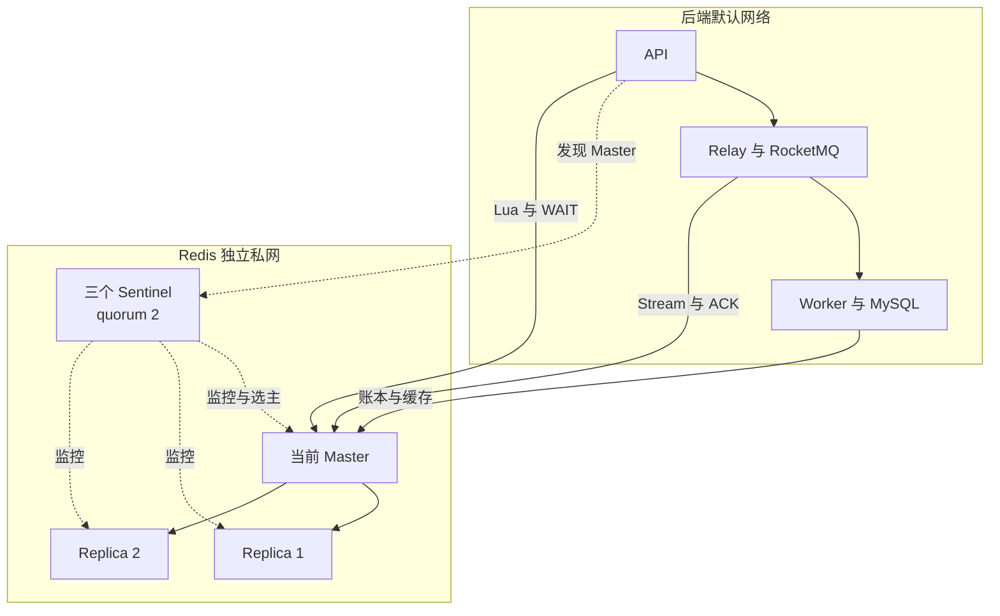

# Redis Sentinel：实现、验收与边界

默认单机配置保留。本改造增加独立的一主两从、三个 Sentinel，quorum=2；Go 使用 go-redis v9.7.0 `NewFailoverClient`，继续执行原来的 Lua 预留、Stream Outbox、Relay→RocketMQ→Worker、SQL 事务和幂等投影。Sentinel 解决发现与进程故障后的主节点选择，不能把异步复制变成强一致。

## 1. 部署与发现



独立实验项目使用 `flashcoupon-ha`，不要把 override 直接叠到正在使用旧业务数据的单机项目上。数据节点各有 AOF 卷，Sentinel 各有可写配置卷；启动只初始化不存在的配置，保留当前角色、Sentinel ID、epoch 和选主结果。旧主恢复后由 Sentinel 重配置为副本，不固定把名为 `redis` 的容器重新当作 Master。

```powershell
# Docker Compose >=2.24.4；在受保护的环境或未提交的 env-file 中设置：
# REDIS_PASSWORD、REDIS_SENTINEL_PASSWORD、ADMIN_KEY、USER_KEY
docker compose -p flashcoupon-ha -f compose.yaml -f compose.sharding.yaml -f compose.observability.yaml -f compose.redis-ha.yaml up -d --build
```

以上命令使用基础 Compose 的 API/MySQL 等端口，启动前确认空闲；不要与原项目争用端口。下文 lab 脚本生成独立覆盖文件，把 API/Relay/Worker 绑定到 loopback 18880/18881/18882，并取消 MySQL/Proxy 宿主端口；SSH 仅转发这些实验端口。重新执行脚本前先安装 `pip install paramiko`，通过 `FLASHCOUPON_SSH_PASSWORD` 或已有 SSH 身份认证，勿把密码写进命令工件。

Redis/Sentinel 不发布宿主端口。`redis-ha` 是 internal 网络，默认 `172.29.239.0/24`；三台数据节点固定 .11/.12/.13，Sentinel 为 .21/.22/.23。可通过 `REDIS_HA_PREFIX` 调整前三段，部署前检查与现有网络不重叠。API/Relay/Worker 同时加入后端网络和 Redis 私网；外部客户端访问 API，不直接连接容器 Sentinel。

这里刻意使用**固定的私网公告 IP**。早期 hostname 方案在 Docker network disconnect 后会撤销节点 DNS，Sentinel 阻塞解析并进入 TILT，实测超过 45 秒未切主。修复后，Sentinel monitor、known peers 和 replica-announce 均使用固定地址，不依赖失联容器的 DNS。已有实验卷升级仅改写这些地址指令，不清空数据、重置 epoch 或重置主角色。源码：[Compose](../compose.redis-ha.yaml)、[持久化启动脚本](../deploy/redis-ha/start.sh)。

数据节点配置 `appendonly yes`、`appendfsync always`、`noeviction`、`requirepass/masterauth`、`min-replicas-to-write 1`、`min-replicas-max-lag 2`。Sentinel 使用独立认证密码和监控认证，down-after=2 秒、failover-timeout=15 秒、parallel-syncs=1；这些是实验参数，不是最坏恢复时间保证。健康检查使用 PING 和 Sentinel CKQUORUM；不能把 PING 成功当作仍有足够副本可写。

## 2. 客户端与受理语义

| 配置 | 作用 |
|---|---|
| `REDIS_MODE=standalone` | 默认 `REDIS_ADDR`，保留原单机部署 |
| `REDIS_MODE=sentinel` | Sentinel 自动发现/切换 Master；所有业务读写都走 Master |
| `REDIS_MASTER_NAME` | 默认 flashcoupon，与 Sentinel monitor 名称相同 |
| `REDIS_SENTINEL_ADDRS` | Sentinel 地址列表，Docker 内可用 sentinel-1:26379 等 |
| `REDIS_PASSWORD` / `REDIS_SENTINEL_PASSWORD` | 数据与 Sentinel 的独立认证，不放入代码或指标 |
| `REDIS_WAIT_REPLICAS` | 0 关闭；HA Compose 默认 1，也验证 2 |
| `REDIS_WAIT_TIMEOUT_MS` | 默认 200；合法范围 1～30000ms |
| `REDIS_OBSERVE_ADDRS` | 仅用于观测三个数据节点，不参与库存裁决 |

主路径仍是 API 鉴权/限流→Lua 原子预扣、限领、请求记录与入箱→后台发券；没有引入每次领取都写 SQL 的 admission 表。Sentinel 模式关闭 go-redis 的透明命令重试，结果不确定时交给客户端使用**相同 request_id** 重试，避免把某次 Lua 或 WAIT 静默搬到另一连接上重做。

受理前在固定连接检查 Master 角色；每个模板在当前 Master incarnation 第一次访问时复用现有完整审计，确认库存/SQL事实/投影和预留账本没有可见冲突。该检查缓存到本次 incarnation，切主或 Redis 重启后失效；不是每次领取都扫描 SQL。Lua 的 HA 前置检查为 O(1)，检查元数据、库存范围、预留/状态数量、revision 及明显的账本缺口，然后保留原有预扣逻辑。

| 普通异步领取接口结果 | 含义与处理 |
|---|---|
| HTTP 202 | Lua 成功；启用 WAIT 时还达到本连接要求的副本 ACK 数。仍不代表 SQL 已发券 |
| 409 | 原有明确业务拒绝，例如库存或限领；不放宽业务条件 |
| 503 + `safe_rejected` | 在执行预留前拒绝，或 Redis 明确以 NOREPLICAS/READONLY 拒绝写入 |
| 503 + `unknown` | Lua/WAIT 的响应不确定，可能已经预留甚至已经最终发券；不得退库存，使用同 ID 重试/查询 |
| 连接丢失 / 未标记的 503 | 客户端保守视为未知，不自行判断“肯定没执行” |

未知结果返回稳定 event_id 和同 ID 重试提示。重放命中原预留，保持 Event 字段和 AcceptedAt，不改变事件哈希；后续 SQL/投影仍由原幂等机制处理。WAIT 不足不会调用补偿；只有原 SQL 发券事务确认的永久拒绝走原补偿。

`safe_rejected` 描述本次尝试没有执行新的预留，不证明同一 request_id 的早先尝试从未成功；尤其不能根据一次重试得到的 503 退回旧预留。批量导入、缓存写入和 MQ 交接仍沿用原机制，本次 WAIT 确认的范围是优惠券领取 Lua，不宣称所有 Redis 写入都经过 WAIT。

已有 `redis_initialized` 是 SQL 中的初始化证据：账本丢失时不重新用 SQL remaining 初始化。HA 对账也不会在 Redis 库存与预留推导不符时自动改库存；只有库存等式已成立时才允许原 CAS 修复派生用户计数。缺失账本需核对并恢复可信 AOF/快照，而不是把 Redis 当作随时可删除的缓存。

相关源码：[redis_ha.go](../internal/app/redis_ha.go)、[claim.lua](../internal/app/lua/claim.lua)、[Warm/Claim](../internal/app/cache.go)、[对账](../internal/app/messaging.go)。Stream 组若因状态恢复暂时不存在，Relay/批次 Worker 从 0 重建组；允许重复消费，不从 `$` 跳过已存在事件。原有 ACK、PEL 接管、清理和 SQL 幂等语义保留。

## 3. WAIT 为什么必须同连接

WAIT 确认的是**当前连接先前写入对应的复制偏移**。从连接池另借一条连接再 WAIT，可能确认的是偏移 0，对本次 Lua 没有意义；把 WAIT 放入 Lua/MULTI 也不能得到期望的阻塞确认。[官方 WAIT 语义](https://redis.io/docs/latest/commands/wait/)

实现借用 `redis.Conn`，执行 EVAL 后，仍在这条连接发送写屏障 SET 与 WAIT pipeline；不用事务 pipeline，关闭透明重试。即使 Lua 是幂等重放、没有产生新写入，也先写一个有界的全局屏障键，让 WAIT 确认到已观察账本之后的位置。屏障不修改 Event，不创建无限的每请求键。读超时覆盖 WAIT 超时，并记录实际 ACK 数、确认/超时/错误和阶段耗时。

例如两副本中一台停机，WAIT=2：Lua 可以在剩余一个健康副本条件下执行，但 WAIT 只确认 1，接口返回 unknown。库存没有自动加回；恢复副本后用原 request_id 重放，重新执行屏障/WAIT，再确认同一预留。真实测试覆盖此场景及两次重放使用同一原始事件。

WAIT 只减少丢失窗口，**不是强一致、分布式事务或副本磁盘刷盘确认**。AOF 是各节点持久化，Sentinel 是选主，min-replicas 是可写门槛，WAIT 是复制确认，各自职责不同。[Redis replication](https://redis.io/docs/latest/operate/oss_and_stack/management/replication/)

即使启用 WAIT，仍不能承诺任意分区/多节点同时损坏下零丢失。min-replicas 也不是多数派写入协议：旧主在检测延迟内、或仍持有足够副本的分区中可能继续写。WAIT=2 比 WAIT=1 更保守，但一个副本不可达就无法给出确定受理成功，存在明确的可用性代价。

### 不能被账本等式发现的损失

若发生完整、内部平衡的历史回滚：某些已受理事件连同库存预扣、用户计数、预留和 Stream 一起丢失，且事件尚未留下 MQ/SQL 证据，当前状态仍可能通过审计。现架构没有独立的逐请求持久接收账本，**无法凭空证明这些事件存在或自动补发**。不能把“审计通过”包装成“任何 ACK 都不会丢”。

策略是保存请求 ID，未知请求同 ID 重试，核对 MQ/SQL 事实；可见账本冲突则关闭受理并保存旧主 AOF/副本快照用于人工核对。怀疑丢失时不要先让旧主全量同步覆盖唯一取证副本，也不要直接按 SQL 剩余库存重建 Redis。本轮自动恢复验证针对有持久依据、正常复制条件下的进程故障，不证明上述完整历史丢失可自动恢复。

## 4. 监控与 Trace

沿用三角色 `/metrics` 和官方 OTel。`redis.ha_guard`、`redis.claim_lua`、`redis.wait` 与原 Relay、MQ、SQL、投影、终态 Span 位于同一 Trace。WAIT Span 附要求副本数和实际 ACK 数，不附密码、请求体或用户标签。

| 指标 | 正确解释 |
|---|---|
| `redis_available` / `redis_writable` | 最近探测的 Master 可读与副本可写条件；不是本次受理结果保证 |
| `redis_node_role{node,redis_role}` | 固定 node_0～2 的 master/slave/unavailable；副本读仅用于此观测 |
| `redis_connected_replicas` | 当前 Master 观察到的连接副本数 |
| `redis_replica_io_age_seconds` | Replica 距离最近 Master IO 的秒数，不是精确消息延迟 |
| `redis_replica_offset_gap_bytes` | 采样偏移差，不同复制历史间不可比较；-1 表示无效 |
| `redis_master_switches_total` / `redis_sentinel_config_epoch` | 各进程观察到的 Sentinel 地址变化与 epoch；不能把三个进程计数求和当集群切主次数 |
| `redis_master_incarnations_total` | run_id 变化，也包含同地址重启，与切主区分 |
| `redis_connections_total` / `redis_reconnections_total` | 主客户端新 TCP 连接；失败探测后的成功恢复，分别计数 |
| `redis_errors_total` | 按有限种类记录错误观察，command/pipeline/admission 可能观察到同一底层错误，不能当唯一失败请求数 |
| `redis_wait_total` / `redis_wait_last_acks` / `redis_wait_seconds` | 确认结果、最近副本数、等待开销；超时不代表回滚 |
| `redis_admission_total{outcome}` | accepted、unknown、safe_rejected；含幂等重放，不等于唯一发券数 |

以上名称均带 `flashcoupon_` 前缀及原有 role 标签，没有用户 ID 等高基数字段。探测有超时和采样间隔，故障期间可能短暂滞后；最终发券仍看 SQL grants 与业务审计，不看 Up=1。

## 5. 真实验收与复现

使用授权 Linux 实验机的独立 `flashcoupon-ha` 项目；保留原 `flashcoupon-observe`、本地单机项目和历史工件。原生 Windows k6 经 SSH 访问 loopback API，服务端独立采样。密码只放在受保护的 `reports/redis-ha.env` 或进程环境，不提交。

```powershell
# 先上传源码及当前 runtime 镜像；离线镜像方法见跨机实验文档。
python scripts/remote_deploy.py --host LAB_HOST --user LAB_USER --directory LAB_DIR --upload-only --image-archive reports/redis-ha-runtime.tar
python scripts/redis_ha_lab.py --host LAB_HOST --user LAB_USER --directory LAB_DIR --setup
python scripts/redis_ha_faults.py --host LAB_HOST --user LAB_USER --directory LAB_DIR --run-tag new-fault-run
python scripts/redis_ha_recovery.py --host LAB_HOST --user LAB_USER --directory LAB_DIR --run-tag new-recovery-run
python scripts/redis_ha_benchmark.py --host LAB_HOST --user LAB_USER --directory LAB_DIR --k6 reports/tools/k6.exe --run-tag new-benchmark-run
python scripts/summarize_redis_ha.py --normal-tag new-benchmark-run --fault-tag new-benchmark-run
```

新 run-tag 保存新工件，不覆盖历史。故障控制仅在宿主 Docker/进程环境，不新增线上故障 HTTP API。主节点崩溃用 stop -t 0，恢复只启动指定容器；不能用会顺带恢复依赖的 Compose start 破坏“Sentinel 恢复、旧主仍停机”的实验条件。

常规基线复用 `claims.js`：500 请求、30 VU、500 库存、每人限领 1，单机与 Sentinel WAIT=0/1/2 各三轮。为保证共享同一 MySQL/Proxy/MQ 时业务数据一致，切换测试 Redis 前停所有写入角色，确认业务收敛，再通过 COPY/REPLACE 复制完整实验 Redis 状态；这只是独立实验夹具，**不是线上丢账后的自动恢复策略**，不清空 SQL、不删卷、不重设库存。

故障对照另用复用原 setup/teardown 审计的 `redis_ha_fault.js`：控制与切主组的请求数、节奏、同 ID 重放规则相同。503 和连接错误仅记为安全拒绝或未知，绝不计入 accepted；结束仍必须最终 issued=projected=500、pending=0、库存一致。故障恢复期间的相同 ID 重试单独计数，不冒充新增受理 QPS。

原业务回归仍用 `scripts/verify.py --faults`，通过 `EVIDENCE_DIR` 指向新目录；真实 Sentinel 固定连接检查可在 HA toolbox 中执行 `go test -v ./internal/app -run TestRedisHASameConnectionIntegration`。源码与配置入口：[lab](../scripts/redis_ha_lab.py)、[故障矩阵](../scripts/redis_ha_faults.py)、[压测](../scripts/redis_ha_benchmark.py)、[Go 测试](../internal/app/redis_ha_test.go)。

结果与逐轮数据统一放在 [redis-ha-2026-11-19](../evidence/redis-ha-2026-11-19/)；工作从 11 月 19 日开始，以下最终压测及恢复验收完成于 11 月 21 日。原始 JSON、审计结果及资源采样见 [summary.json](../evidence/redis-ha-2026-11-19/summary.json)，规范化 LF 后的 SHA-256 见 [manifest.json](../evidence/redis-ha-2026-11-19/manifest.json)。新执行时选择新标签；汇总脚本只选择指定标签中通过完整审计的试验。

### 最终实测结果

下表各组均为三轮中位数；每轮 500 次初始请求、30 VU、500 张库存，所有有效试验最终均为 issued=projected=500、pending=0、库存一致，共 18 轮、9000 张券。正常组来自 `benchmark/verified-20261121`；定速控制与切主组来自 `benchmark/resilience-final-20261121`。正常组不主动等待；后两组每次迭代额外等待 100ms，且都在结束时重试所有相同 request_id，因此只能在各自组内对照。

| 场景 | HTTP 受理 QPS | 最终发券 TPS | HTTP P95 / P99（ms）| 初始失败率 |
|---|---:|---:|---:|---:|
| 单机，WAIT=0 | 915.75 | 100.97 | 51.56 / 105.44 | 0% |
| Sentinel，WAIT=0 | 640.20 | 81.77 | 111.08 / 139.27 | 0% |
| Sentinel，WAIT=1 | 422.30 | 76.34 | 110.49 / 152.87 | 0% |
| Sentinel，WAIT=2 | 398.72 | 83.74 | 126.36 / 130.37 | 0% |
| Sentinel，WAIT=1，定速控制 | 160.57 | 73.10 | 131.79 / 136.13 | 0% |
| Sentinel，WAIT=1，定速切主 | 67.81 | 30.61 | 4064.60 / 4117.51 | 6.6% |

HTTP QPS 只统计初始阶段返回 202 的请求；故障时的 503/断连不计成功。最终 TPS 从测试开始计至最终审计收敛，含后台发券、客户端重试和审计轮询时间，不是持续稳定运行时的数据库极限。正常组延迟为 k6 HTTP 请求分布，故障组为初始领取请求分布，排除后续重试；错误率则以初始 500 次尝试为分母。原始 JSON 另存包含重试的 HTTP 失败率，二者不可互换。

三轮切主的选主耗时中位数 **4.88s**，恢复到一主两从同步的耗时中位数 **21.72s**；相同 request_id 重试后均完整发券，未发现超发、重复或不可恢复漏发。WAIT=1/2 正常组的服务端屏障及 WAIT 平均耗时中位数分别为 **19.80/19.93ms**，三轮未发生 WAIT 超时；另有故障用例真实触发 WAIT=2 仅确认一个副本，返回 unknown，随后同 ID 收敛。

收益证据是**自动选主、三角色连接恢复和指定故障后的业务收敛**，不是吞吐提升。Sentinel 模式还有 Master/账本检查、复制、AOF 和观察开销；WAIT 增加写屏障及等待，不能把所有差异归因于 WAIT。正常负载下最终 TPS 没有提高，SQL 模板行锁、事务与分片投影仍然存在。

正常组活跃 Redis 容器的采样内存峰值中位数：单机约 **21.15MiB**，Sentinel WAIT=0/1/2 约 **89.73/96.18/85.80MiB**；对应 CPU 峰值 **14.22% / 48.25% / 57.65% / 56.06%**（Docker CPU 百分比，100% 约一核）。HA 统计三个数据节点和三个 Sentinel，单机只统计活跃单节点；保留的闲置对照 Redis 未算入。此处是容器内存，**不是 Stream 内存**。历史账本随实验增长、采样间隔及共享实验机也影响数值，不能据此推导稳定容量。环境及镜像见 [environment.json](../evidence/redis-ha-2026-11-19/environment.json)。

### 故障与回归证据

- [故障矩阵 run3](../evidence/redis-ha-2026-11-19/faults/run3/summary.json)：10 个场景，含主/从停机、单个/多数 Sentinel 故障、运行中主从隔离、并发切主、PEL 接管及重复投递、旧主回归、WAIT 不足、复制不足拒写、账本损坏拒绝受理。最终检查 SQL、分片投影、限领及库存。
- [最终恢复验收](../evidence/redis-ha-2026-11-19/recovery/acceptance-20261121/summary.json)：5 个场景，含组丢失后原进程重建、全体 Redis AOF/持久 Sentinel 状态恢复且三个 Go 进程未重启、私网与认证、Lua 成功后 API 被 kill 的同 ID 恢复、包含 guard/WAIT 的三角色 Trace 及全局审计。
- [固定连接集成测试](../evidence/redis-ha-2026-11-19/recovery/final-20261121/same-connection-integration.json)：真实 Sentinel 下 EVAL/WAIT 前后 CLIENT ID 相同，另一连接幂等重试保持唯一预留并最终发券。
- 原业务真实中间件回归、race、vet、SDK 竞态反例及旧故障注入使用 [final-regression-20261121](../evidence/redis-ha-2026-11-19/final-regression-20261121/)；不会用 mock 结果代替故障验收。

早期 hostname 导致 TILT、Compose start 意外拉起依赖、复制夹具认证缺失、切主未覆盖请求窗口及 SSH 会话中断的失败记录保留，均不混入有效中位数。中断后复用 ID 的第三轮可能读到旧资源采样，故整个 `resilience-20261121` 标签排除，改用全新 ID 重跑三组；脚本已拒绝采样 ID 冲突，并校验采样开始时间覆盖故障时间。不把 SSH 错误记作 Redis 恢复耗时。

**部署范围：** 所有 Redis/Sentinel 容器在同一 Linux 物理机，只验证进程级故障转移；不是跨物理主机/机房 HA。MySQL 依旧单实例、两个优惠券逻辑库及四张用户券表。没有新增自动运维告警、强一致共识或无限恢复能力。
