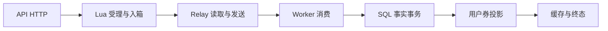

# 全链路追踪与 SQL 观测

本轮新增观测，不改变默认发券语义。主线仍是 Redis 原子受理、Stream 持久事件箱、Relay 交接 MQ、Worker 提交 SQL 事实，再补齐用户券投影与 Redis。Trace 用来解释一次请求去了哪里、时间花在哪里；是否真正发券成功仍由 SQL 事实和最终审计判断。

## 启动与查看

```sh
docker compose -f compose.yaml -f compose.sharding.yaml -f compose.observability.yaml up -d --build
```

访问本机 `http://127.0.0.1:16686`，选择 `flashcoupon-api`，搜索 `POST /v1/claims`，展开同一 Trace 下的 Relay、Worker。Jaeger 固定为 2.21.0，原始查询接口是 `/api/v3/traces/{traceID}`，不是旧版 `/api/traces`。Jaeger 使用内存存储，重启会丢追踪记录；提交的脱敏 JSON 是独立证据，不承诺 UI 永久保留。

| 配置 | 默认 / 作用 |
|---|---|
| `TRACING_ENABLED` | 基础部署为 0；观测 override 为 1 |
| `TRACE_SAMPLE_RATIO` | SDK 默认 0.1；实验固定 1，合法范围 0～1 |
| `OTEL_EXPORTER_OTLP_ENDPOINT` | `http://jaeger:4318`，OTLP HTTP |
| `WORKER_CONCURRENCY` | 默认 20，可选 1～128；改变 MQ 消费协程数 |

SDK 使用 ParentBased 采样：收到合法上游 sampled Trace 时沿用采样决定，因此比例不是外部请求的硬上限。k6 实验为每个请求显式生成 sampled W3C `traceparent`；关闭 Trace 时使用 noop provider。实际工程中应在可信入口管理外部采样策略，本项目没有新增网关。

## 一次发券如何串起来



`internal/app/telemetry.go` 使用官方 OTel Go SDK 1.35.0、W3C Trace Context 与 OTLP exporter。每个 Service 有独立 provider，资源名为 `flashcoupon-api/relay/worker`。HTTP 提取上游 context，响应头返回 `traceparent`，Span 仅记录路由模板、方法与状态码。

Lua 接收的业务 `Event` 和稳定事件 ID 保持原样。追踪载体另存在 Stream 的 `trace` 字段及模板 trace hash：预扣、预留、事件入箱在同一个 Lua 调用中发生，**没有人为拆出一个无法独立测量的 Redis 服务端 XADD Span**。Relay 从载体恢复上下文，把它注入 MQ properties；Worker 提取后继续追踪。对账补投从 trace hash 恢复原上下文；MQ 消费重试保留同一 Trace，并通过 Span Link 关联收到的前序上下文。这不是完整的历次重试链索引。

| Span / 源码 | 表示什么 |
|---|---|
| `http.auth`、`http.admin_auth`、`http.rate_limit`；`http.go` | 入口校验及 Redis 限流耗时 |
| `redis.claim_lua`；`cache.go`、`lua/claim.lua` | 原子库存预扣、限领、预留及 Stream 写入 |
| `queue.stream`、`relay.read`、`mq.send`；`messaging.go` | Stream 等待估计、Relay 处理与 MQ 同步发送阶段；mq.send 当前包含后续 ACK 开销 |
| `queue.rocketmq`、`mq.consume`、`worker.deliver`；`messaging.go`、`cache.go` | MQ 等待估计、消费尝试及发券处理 |
| `sql.transaction`、`sql.begin/lock_template/inventory_update/fact_insert/commit`；`store.go` | 控制库事务及各客户端步骤 |
| `coupon.projection`、`coupon.cache`、`redis.finalize`；`cache.go` | 分片投影、用户缓存、Redis 业务终态 |
| `redis.compensation`、`reconcile`；`cache.go`、`messaging.go` | 已确认永久失败的预留归还、定时对账 |
| `recovery.warm`、`recovery.projection`；`cache.go`、`recovery.go` | 库存预热/恢复和事实到用户券的投影修复 |
| `mq.transaction_send/local`、`sql.transaction_admission`、`transaction.recover`；`transaction.go` | 隔离的事务消息实验，见[方案对照](ARCHITECTURE_COMPARISON.md) |

队列等待通过已记录的入队时间与当前时间估计，分别记录 `queue.wait_ms` 与阶段 histogram。Stream 使用消息 ID 的毫秒时间部分；MQ 时间取发送端时间，包含发送确认/调度等开销，不能当作 Broker 内部精确驻留时间。历史时间 Span 可能触发 Jaeger 的时钟偏移提示，跨机器还需要时钟同步；本轮跨进程业务均在同一服务端，仍不以单个 Span 代替统计实验。

## 数据库时间如何读

`sql.lock_template` 是 Go 客户端 SQL 调用时长，可能含连接池等待、网络与数据库执行，不能命名为“纯引擎锁等待”。`sql.DB` 的 `flashcoupon_db_connections_open/in_use/idle`、`flashcoupon_db_pool_wait_total` 和 `_seconds_total` 分别提供连接数与累计池等待。池标签只有 control/coupons，角色标签只有固定 ROLE。

`scripts/server_collect.py` 独立采集 `performance_schema.data_lock_waits` 等待关系数、`information_schema.innodb_trx` 等待事务数、control 库 SQL digest 次数/累计时间以及慢日志计数。等待关系数不是等待事务数：20 个事务竞争同一行时可能形成 210 条关系。锁阻塞实验真实持有模板行锁 12 秒，再释放；查看同测试 ID 的 `*-server.json` 与 Trace，能够区分“入口受理很快”和“后台 SQL 正在等锁”。

实验临时开启 TABLE 慢日志，阈值 50ms，结束恢复原全局配置。只提交计数，不提交 SQL 原文。摘要的 stage 平均值来自两次采样的 sum/count 差，短负载可能在首样本前结束，因此不保证涵盖全部请求；P95/P99 一律取 k6 的 `claim_latency`。

## 失效隔离与证据

exporter 异步批量发送，队列上限 2048，500ms 刷新，单次导出 2 秒超时且关闭 exporter 重试；拥塞时允许丢 Trace，不能阻塞发券。关机最多等待追踪 shutdown 3 秒。Jaeger 不在业务启动依赖中，真实停机发券测试见 [checks.json](../evidence/observability-2026-11-19/checks.json)。应用错误 Span 使用固定说明，不导出原始 SQL 错误、签名、DSN 或请求正文。

完整三服务 Trace 与 HTTP/SQL/投影/终态阶段已由实验入口自动核验，工件在 [experiments](../evidence/observability-2026-11-19/experiments/)。复现运行 [verify_observability.py](../scripts/verify_observability.py)，实测统计见[跨机实验](DISTRIBUTED_EXPERIMENT.md)。本轮没有部署 Prometheus Server 或自动运维告警，保留各角色 `/metrics`，可用原有 PromQL 查询。

最终镜像的 [本地部署验收](../evidence/observability-2026-11-19/local-final-deployment.json) 与 [Linux 部署验收](../evidence/observability-2026-11-19/linux-final-deployment.json) 均通过；各自保存 `*-final-trace.json`。`smoke_distributed.py` 可在已有栈上重验三角色健康、5 张实际发券、Jaeger UI HTTP 200、三服务核心 Span 与全部模板最终审计。
